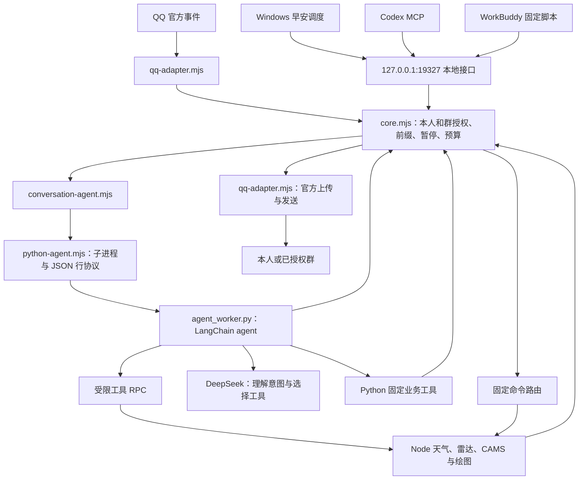
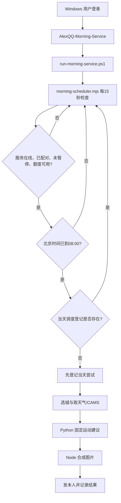

## 2026-11-03 官方 Bot 上线新版控制台、快速群匹配和全局唤醒词

按用户要求，将后续控制台功能择项迁入官方分支，没有合并或重新启用 OneBot。生产已于 09:15:19 CST 完成切换，当前 release `linux-1f0ee52c49ae`，运行代码提交 `4d1882a903b8d6a57f069481c80a40afc3b4232a`，280 个发布文件哈希一致。主服务 PID 106322 于 09:15:13 CST 启动；09:25:29 再次核对实际 19327 监听、argv `/usr/local/bin/node /opt/alex-bot/current/codex-qq-plugin/src/server.mjs --connect`、cwd `/var/lib/alexbot`、显式 `QQ_TRANSPORT=official`、源码先于启动及四份实际 HTTP 静态资源哈希，均通过。connected、paired、未暂停、未决投递 0、NRestarts=0，发送计数全程 6→6，没有 QQ 测试发送。本机隧道曾退出而云端 Bot 仍在线，已只恢复受限 SSH；当前 127.0.0.1:19327 由 ssh.exe PID 40880 监听，没有启动本机 Bot。

新版控制台采用侧栏、分栏和滑动开关，天气/空气及换算/生活费预算合并，使用“AI服务状态”“DeepSeek余额”“早间日报”名称。官方快速群匹配流程为：添加群、填写备注、生成五分钟一次性匹配指令，在目标群 @ 官方机器人并发送，然后回控制台确认授权。捕获指令不自动授权、不回复；新控制台明确提交基础功能配置，旧 API 省略可选参数时保持原默认。官方事件中的成员 OpenID 不要求与主人私聊 OpenID 相同，候选群、口令及确认步骤均校验。群名为管理员备注；没有引入普通 QQ 登录、群列表抓取或扫码入口。

任意页面增删改唤醒词都会更新全局词库；群页只独立保存逐词开关，稳定词 ID 保证改名后保留关闭状态。字面量前缀匹配，不执行用户正则；每词后以空格分隔问题，官方 @ 仍可使用。仅从退役状态恢复原 6 个全局词及 revision=1，未迁移 OneBot 主人、UIN 群授权或逐群开关。原官方主人、两个白名单群、灰名单、入站去重及全部投递/尝试记录保持；模型预算、SQLite 记忆、凭据、限额和共享配置的切换前后哈希均一致。各功能同时受 Node 授权和 Python LangChain 工具范围约束，新增协议参数保留默认兼容。

逐群“早间日报”接入新的官方 `alexbot-group-morning.service` / `.timer`，每日北京时间 07:30，`Persistent=false`；当前两个群均关闭，订阅数 0，下一次调度为 2026-11-04 07:30。只有用户明确在群页开启并保存后，才从下一个 07:30 发送，不能补发停用期间日报。旧全局 `alexbot-morning.service` 仍 masked，旧配置 enabled=false；OneBot 业务、网关、控制、试运行及其日报 service/timer 六项均继续 masked/inactive。当天 08:25 的一次性补发是此前用户单独授权的操作，完成回执 `/var/backups/alexbot-morning-catchup/20261103/completed.json`，当日 claim 保留，不能再次补发。

本机完整 Node 516/516、Python 277/277 通过，包含真实 Node→Python LangChain 调用、新群匹配授权及腾讯 SDK 事件的自定义唤醒词重复投递路径。ECS 仅在独立 MemoryMax=128M、MemorySwapMax=0、CPUQuota=50% cgroup 内通过官方流程三项 Node、两项 Python 专项及只读状态迁移验证，没有运行 Linux 全量回归或 OneBot 发布保护。浏览器独立 fixture 验证全局增删改、跨群开关隔离、改名保留关闭状态及完整群匹配确认流程；随后在正式隧道控制台只读验收真实两群、6 词、开关及快速匹配入口，没有更改线上授权或开关。正式截图在忽略目录 `codex-qq-plugin/test-output/official-console/official-console-live.png` 和 `official-wake-words-live.png`；真实手机新群匹配及首次 07:30 日报尚未触发。

切换前加密备份 `alexbot-20261103T011512763Z.json`，22 文件，SHA256 `884a22fc4a55abe0212cca09c016eeab8a9355ef2ee2542223b65ee90f6d0336`；切换后 `alexbot-20261103T011817559Z.json`，22 文件，SHA256 `158f0140a9491920c4a9a3e54272f2a4726a920eeacc9e058af105e70018d4e3`。云端位于 `/var/backups/alexbot`，本机密文保留于 `.private/migration`，两份均已核对哈希并通过 DPAPI 身份恢复与内存解密验证，没有写出明文。部署、专项、冻结状态、前后备份及最终验收回执在 root 专用 `/var/backups/alexbot-official-console/20261103`，最终回执 `final.json`；旧 release 保留，可只回退代码而不覆盖最新运行状态。

仍使用 `codex/official-bot-rollback-20261103`，OneBot 历史分支保留。只做本地 Git 记录，未更新 GitHub；用户已有的 backup.mjs 修改、暂停的提醒源码及其它未完成工作未提交或部署。下方回滚记录及更早内容为历史，运行状态以上节为准。

## 2026-11-03 已回滚到 QQ 官方 Bot

按用户“回滚到 qq 官方 bot 的版本，onebot 封号太严重”的明确指令，于 07:44 停止 OneBot 发送、业务、网关、登录控制和相关定时任务。切换前为 ONEBOT_DISCONNECTED、已暂停、当日 0 次发送、无未决投递。已恢复最后一次正式使用官方接入的 `linux-10443702394a`，源码 `e0c356c7828572b78894619ecf5e076009e97bac`，266 个发布文件哈希全部一致。`alexbot.service` 显式 QQ_TRANSPORT=official、enabled/active；PID 105680 于 2026-11-03 07:55:46 CST 启动，19327 实际监听、argv、工作目录 `/var/lib/alexbot`、current 指向和源码先于启动均已核对。本机 127.0.0.1:19327 是 OpenSSH PID 29776，于 07:40:12 CST 启动，没有启动本机 Bot。

07:56:59 CST 官方 SDK 已真实鉴权 connected，原主人已配对、发送已恢复、0 次当日发送、0 未决，恢复原 2 个白名单群，灰名单 0。没有发送自动 QQ 测试消息；主人随后向原官方机器人私聊发送“1马里换公里”，并明确确认收到正确的 3.08 公里回复，官方私聊收发及实际工具换算验收通过。群聊未另作实收测试。OneBot 的 UIN 授权没有映射到官方 OpenID。OneBot 业务、网关、登录控制、试运行、日报 service/timer 六项全部 masked，19328/19330 已无监听，开机不会自动拉起。旧官方早报仍 masked，配置 enabled=false；本轮不补发 07:30 日报。原五个前缀及官方白/灰名单随版本恢复，OneBot 的逐群功能、全局自定义词库和扫码页面未迁入旧版。

标准备份 `alexbot-20261102T234943484Z.json`（UTC 命名，CST 11 月 3 日 07:49）包含 21 文件，密文 SHA256 `df655c50d4f4d7a3f22e15329c453a21348e7fe25efc1cf35a09bc978846d397`。完整运行目录独立 AES-GCM/RSA-OAEP 密文 `/var/backups/alexbot-official-rollback/20261103/onebot-full-before.json`，38,015,420 字节，密文 SHA256 `86ffb38efec9fa5344edb69958c8c3da34147ef0facd35ad9ffe6bd0aa0425fb`；解密 gzip tar 28,510,970 字节、282 条目，明文归档 SHA256 `548cc615bfea07c47255c8df320d01209021a51f79edd7f4e5df3e095d9911d8`。两份密文已下载到本机 `.private/migration`，哈希一致、DPAPI 恢复身份与内存解密验证成功，未提取明文。完整备份保留全部 OneBot 阶段词库、配置、状态及记忆，网关自身设备/缓存目录保留不再运行。

官方主人/群 ACL 从 `/var/backups/alexbot-onebot-cutover/20261102-owner/old-state.at-freeze.json` 取回；投递按幂等键、尝试按完整记录、入站按哈希合并最新状态，恢复计划为 184 条投递、50 条尝试、152 个去重键，容量检查与旧 BridgeCore 真正载入验证通过。过去身份映射造成的不同目标/请求人哈希记录保守保留，没有清空历史或降低已用额度。当前模型预算、聊天 SQLite、模型/校园/监控配置、两个运行令牌、聊天规则和发送限额前后哈希一致。回滚脚本、原单元、状态计划、备份及恢复/启用回执在 root 专用 `/var/backups/alexbot-official-rollback/20261103`。

Windows Python 275 项全部通过；Node 489 项首次 488 通过，唯一失败是 HTTP fixture 的 fetch 报 bad port，相关 server 文件 14 项独立复查全部通过，未修改业务代码掩盖失败。首次受限执行曾因 Windows 临时目录/DPAPI 访问被拒绝而失败，改为本机正常用户权限和 UTF-8 后，备份验证及 Python 全量通过。真实 Node→Python LangChain 固定换算测试通过。ECS 仅在独立 128M/零 swap/50% CPU 单元中验证恢复状态与凭据格式，没有在 2G ECS 运行完整回归；实际官方 SDK 连接另由生产服务验证。恢复后可用内存约 882 MiB，未决投递 0。

工作区已切到 `codex/official-bot-rollback-20261103`，`codex/onebot-migration` 保留原 OneBot 提交；用户的 backup.mjs/提醒及其它未完成工作保持。切分支前的未提交补丁及原 backup.mjs 副本保存于忽略目录 `codex-qq-plugin/test-output/official-rollback`。本次只做本地 Git 记录，不更新 GitHub；文档以本节为当前状态，以下为历史。

## 2026-11-01 全球雷达与国内缺图自动回退（已上线）

默认radar_image先取中央气象台，目标不在目录、无当前图或图过期等情况下自动尝试RainViewer全球拼图；有多个国内站名匹配时仍要求澄清，不猜位置。新增可选source=global，旧调用省略参数仍为auto。支持自然语言海外地名，“发 雷达 纽约”“发全球雷达 东京”“发 雷达 全球”“全球雷达图”。全球视图与区域图同条发送图片、简短来源；灰名单权限不变，国内原图保持原样。模型提示已明确雷达不限中国，并清理此前残留的“天气仅当天”冲突句。

新业务由受限Python LangChain global_radar_image实现，仅target地名参数，无URL/路径/命令/凭据/收件人。固定RainViewer清单、雷达/覆盖瓦片与Open-Meteo地理编码域名，禁止重定向/未知host/path；验证最新拼图帧60分钟时效。透明覆盖区与缺测区分开处理，灰纹明确表示无覆盖，不把无覆盖当作无降水；帧时间标明北京时间，非单站统一观测时刻。全球图1080×1370含回波图例、查询位置和来源。全球worker90秒、外层radar工具阶段150秒；单次公网请求10秒，有超时提示。Node仅路由、图像验证与QQ发送。

底图优先OSM，仅加载当前视口瓦片，独立UA，缓存至少7天，缓存512项上限；缓存过期清理不提前删除7日内瓦片。ECS无法访问OSM瓦片，已加入公有领域Natural Earth 1:50m海岸线+国家名位置底图，坐标与雷达同为Web Mercator；底图失败只替换底图，不替换回波或覆盖数据。失败后一小时内不重复请求OSM。来源/上游SHA256在data/global-radar-base-NOTICE.txt。RainViewer要求署名、无Key及免费个人用途条款已核对：https://www.rainviewer.com/api/weather-maps-api.html；底图条款：https://www.naturalearthdata.com/about/terms-of-use/。

当前生产`linux-5e4d642a771d`，源码`9787355`（功能首提交11b738b）；主PID81523于2026-11-01 22:19:00 CST启动，早报PID81541，本机SSH PID44864。源码清单、实际监听、argv、源码早于启动均核验，connected/paired/未暂停、计数18→18、无不确定投递；两白名单群、配置、限额、07:30规则与每日claim保持。Windows Node482/Python274（海岸线补充后专项5项通过）；首候选Linux完整Node477通过/5项Windows专用跳过、Python274；最终候选相关Node70、完整Python275通过。真实模型、真实跨语言及纽约/东京/全球图片、模拟国内NOT_FOUND后实际全球回退均通过，无QQ测试发送；云端东京海岸线版下载后已目视核验，图片/坐标/署名正常。实际QQ收图仍需用户使用新命令确认。

最新备份`alexbot-20261101T141540561Z.json`已本机内存验证20文件可恢复；旧release及`source-linux-e47eeccc6667-before-global-radar-20261101T141900Z.tar.gz`保留。未推送GitHub；提醒仍暂停且未纳入本次提交或部署，其tracked补丁保存位置见上一记录，恢复时须合并server等最新修改。

## 2026-11-01 分环节超时提示（已上线）

用户要求超时失败时明确提示具体原因。新增固定阶段/时限文案及安全超时元数据：区分模型20秒、预报/定位15秒、雷达10秒、Python任务的实际60/120/210等时限、校园页面25秒/教室接口20秒/登录等待40或交互150秒/页面操作3秒、余额接口每次8秒、媒体下载10秒/视觉和ASR模型20秒、记忆任务10秒和风速计算10秒。仅实际超时使用超时措辞，不把普通网络、鉴权、格式错误伪称超时；不显示上游错误原文或凭据。天气部分源超时仍发送可用图，同条富媒体文字说明缺失原因；校园失败保持JSON并附安全message。后台观察/监控不额外发群消息。

QQ上传超时且确认尚未提交消息时，使用独立幂等键尝试一次文字提示，不重发图片；消息已提交后超时仍属投递不确定，保留暂停及去重保护，无法保证再通过QQ发送提示。未设置统一端到端时限，本轮不改变原有各环节时间限制。未完成提醒功能不在提交/部署中。

源码`7a374fe`，生产`linux-e47eeccc6667`；主PID79917，2026-11-01 21:36:49 CST启动，早报PID79935，本机SSH PID44864。源码清单、实际监听/argv、源码先于启动核验。connected、paired、未暂停，计数14→14、无不确定投递；两白名单群、限额、07:30规则与每日claim保持。Windows Node480/Python269通过；Linux Node475通过、5项Windows专用跳过，Python269通过；真实Python进程短时限触发与之后正常LangChain固定换算均验证，无模型请求/QQ测试发送。云端验收初次缺QQ_PYTHON路径，补齐生产固定路径后全量通过；全量耗时超过Workbench60秒窗口，最终独立回执核验通过。

备份`alexbot-20261101T133046002Z.json`本机内存验证20文件可恢复；旧release及`source-linux-19d649813824-before-timeout-notices-20261101T133649Z.tar.gz`保留。仅本地Git，未推送GitHub。暂停的提醒tracked补丁保存在忽略目录`codex-qq-plugin/test-output/timeout-notices/paused-reminders.patch`，旁边有core/python-agent/server/backup完整.paused副本；未自动重新应用，恢复开发前须与当前超时修复合并检查，禁止直接覆盖新文件。提醒独立源码仍为未跟踪文件。

## 2026-11-01 明天气象图改为明后两日（已上线）

按用户要求，“北京明天天气”现在展示明天00:00至后天24:00；未指定日期/今天保持今天与明天。受限LangChain weather_image新增可选day=today|tomorrow，旧调用省略参数仍默认today。自然语言明天/明早/明晚及明天ISO日期由Python固定传递tomorrow，避免模型漏掉可选参数。Node只按有限day选择既有天气/CAMS采集及绘图；实际获取时间及模型新鲜度仍使用真实now，不通过伪造now移动日期。温度/体感、降水、云量、CAMS PM2.5、风力简报及所有日期文字一同平移。每日07:30早报默认不变。

生产`linux-19d649813824`，源码`127157c`；主PID77915于2026-11-01 21:12:49 CST启动，早报PID77934；源码清单、实际监听/argv、源码早于启动均核验。connected、paired、未暂停、计数13→13、无不确定投递；两白名单群、限额、配置及每日claim保持。Windows Python49/Node52通过；Linux Python49/Node53通过。云端真实模型原句路由和真实LangChain执行产生48小时天气+CAMS图：2026-11-02 00:00至2026-11-04 00:00（即11月3日24:00），图已下载目视核验日期/明天后天/风速文字及曲线。未发送QQ测试。

备份`alexbot-20261101T131107793Z.json`已本机内存验证20文件可恢复；旧release及`source-linux-33e5b37f66f6-before-weather-start-20261101T131249Z.tar.gz`保留。发现本机19327隧道未运行，已通过既有start-cloud-tunnel恢复受限SSH，实际PID44864、21:13:21 +08启动，无本机Bot。未推送GitHub。定时提醒仍停留未完成工作区，未提交/部署。

## 2026-10-31 QQ单次拒发导致全局停发（修复已上线，待群内复测）

23:09群天气请求已完成模型/工具阶段，发送阶段被QQ明确拒绝，旧BridgeCore将其归类PLATFORM_REJECTED并全局暂停；WebSocket仍connected，非断线、非模型掉线。旧诊断未保留具体业务码，不能断言QQ拒发的具体原因。现仅将明确消息/目标拒绝改为不全局暂停，保留不重试、计数及幂等；鉴权、平台限流、内容拒绝、致命、投递不确定和存储异常仍保持原暂停保护。Adapter新增可选lastSend脱敏诊断，仅记录时间、作用域、阶段、固定错误类别及HTTP/业务数字码，不记录内容、身份和密钥。

源码`2ec7167`，生产`linux-33e5b37f66f6`；主PID72564于2026-10-31 23:16:43 CST启动，早报PID72582，本机SSH PID35300。Windows/Linux相关117项回归通过；源码清单、实际监听、argv及源码先于启动核验。仅恢复本事故PLATFORM_REJECTED造成的暂停，不覆盖人工暂停。connected、paired、未暂停，计数15→15、无不确定投递，名单、限额、07:30规则及每日claim保持。已请用户在原群复测天气图。23:17只读检查已记录两次新请求成功投递（约1.3/1.4秒），计数17、connected且未暂停；尚未获得用户对天气图片实际收图的确认。

备份`alexbot-20261031T151552008Z.json`已本机内存验证19文件可恢复，旧release及`source-linux-b14a086d169c-before-outage-20261031T151643Z.tar.gz`保留。未推送GitHub；未完成定时提醒保留工作区，未进入提交或部署包。

## 2026-10-31 明天天气自然语言路由修复（已上线）

用户原句“大肥鱼 明天北京什么天气”曾返回unsupported_time。根因是两日天气图已覆盖明天，但Python工具描述、系统提示及确定性时间校验仍拒绝明天；与蓝色主题变更无关。现已同步修正：今天、明天、明早/明晚和未来两日可调用同一48小时图，历史/后天/更远日期仍拒绝，雷达仍仅当前观测；显式日期支持月末/年末滚动。

源码`ec30473`，生产`linux-b14a086d169c`；主PID72294，2026-10-31 23:07:06 CST启动，早报PID72312，本机SSH PID35300。源码清单、实际监听、启动时刻/argv及源码先于启动已核验。connected、paired、未暂停，计数13→13；两白名单群、运行配置及早报claim保持。Windows Python48/Node22通过；Linux Python48/Node36通过；真实模型在合成白名单群上下文正确将原句选为weather_image并生成317139字节图片，未发送QQ测试。

备份`alexbot-20261031T150506768Z.json`已在本机内存验证19文件可恢复，旧release及`source-linux-8bb44d1fce41-before-weather-route-20261031T150705Z.tar.gz`保留。仅本地Git，未推送GitHub。定时提醒需求按用户“先等下”暂停，尚未修改提醒功能代码。

## 2026-10-31 蓝色控制台与新 Logo（已上线）

用户要求提交并部署原本留在工作区的界面改动。源码提交`73c46c8`，生产`linux-8bb44d1fce41`，包含蓝色控制台/指南样式、PNG Logo及来源说明、PNG静态路由与正确MIME。未推送GitHub。

Windows与Linux控制台各14项测试通过。主服务PID71859于2026-10-31 22:59:25 CST启动，早报PID71877；源码清单、实际监听、argv及源码早于启动均核验。SSH隧道PID35300，启动13:58:30 +08。经本机隧道读取页面已确认蓝色变量、PNG引用、image/png及Logo SHA256一致。服务connected、paired、未暂停；发送计数10→10、无不确定投递，运行配置和每日早报claim保持一致，未发送QQ测试。

切换前加密备份`alexbot-20261031T145741603Z.json`已保存云端与本机受保护恢复目录，内存验证19文件及密钥配置可恢复、未写明文。旧release和`source-linux-3b543066a571-before-console-blue-20261031T145925Z.tar.gz`保留可回退。Workbench download本轮失败，改经已认证exec传回密文并验证成功。

## 2026-10-31 标题两日风力范围与最大阵风（已上线）

按用户标出的标题中间留白，新增今天/明天两行简报，标明ECMWF / Open-Meteo来源。最终按用户追加要求显示“主要风向 n–m级 · 阵风最大k级”。数据取10m平均风速、风向与独立阵风字段，平均风力和阵风分开计算；ECMWF阵风为前三小时窗口最大值，按每日03/06/.../24时闭合窗口覆盖当日，不把前日窗口混入本日。无有效值标缺失，部分小时明确标注；没有以平均风速假造阵风。

新业务在受限Python LangChain `wind_brief`工具计算：最多48个数值、固定风级阈值、按两日拆分及主要方向分组，无网络/命令/收件人参数。Node只从固定ECMWF接口取数，以受限stdio交给固定Python程序，不传模型或校园密钥；新增gusts参数可选，旧两字段调用仍兼容。标题宽度为城市、风速简报和日期分别预留，天气图与早报共同生效。Python失败仅风速区显示缺数据，不抹掉其他预报。

生产`linux-3b543066a571`，源码`fc5d920`；主PID71624于2026-10-31 22:49:58 CST启动，早报PID71643。源码清单、argv、实际监听、源码早于启动已核验，SSH PID35300；connected、paired、未暂停，计数10→10，07:30/名单/限额/每日claim保持。Windows相关35项、Linux相关45项通过，含真实LangChain跨语言、北向359/1度、静风/真零、缺失、阵风独立阈值及日界排除；真实48小时预报/天气与早报图均已验证。临时CAMS查询失败后有一次新的完整实查通过，无旧数据冒充当前结果。

本轮两次代码更新均有加密备份：`alexbot-20261031T144239874Z.json`与最终`alexbot-20261031T144637734Z.json`已在本机内存验证19文件可恢复。最终源码备份`source-linux-33d073fb97b5-before-curves-20261031T144958Z.tar.gz`及旧release保留。未发送QQ测试，未推送GitHub。45项Linux回归为当前小范围修改验收，未重复无关完整回归。

## 2026-10-31 温度与体感增加定时数值（已上线）

单城市两条温度曲线每6小时及末小时标数值，同时保留高/低/恒温标记；体感使用淡色并明确写“体感”。双城市为减少拥挤每12小时标注。碰撞检测避让，无空位则省略该标签，偏移超过28px有细引导线，文字白色描边取代大块遮挡底色。未改变数据与48小时范围。

生产`linux-159e04b54374`，源码`cd75b96`，主服务PID71071于2026-10-31 22:37:22 CST启动，早报PID71088。源码哈希、argv、启动时间及实际端口核验通过，connected、paired、未暂停；计数10→10，配置和每日claim保持。云端42项相关回归通过，真实LangChain天气/早报生成正常，已目视审阅标签及引导线。加密备份`alexbot-20261031T143616205Z.json`已下载并内存验证19文件可恢复，旧源码`source-linux-7aaa3509aa6c-before-curves-20261031T143722Z.tar.gz`保留。仅本地Git，未推送GitHub。

## 2026-10-31 体感温度淡色叠加（已上线）

温度面板新增ECMWF接口的`apparent_temperature`，由Open-Meteo根据ECMWF气象字段派生；严格按行首时刻摄氏度取值，缺失保持null。以40%透明度淡虚线绘制在主气温曲线后，标注“淡虚线：体感温度”，不重复标极值；纵轴同时容纳两条曲线，保留边缘留白与monotone插值。天气和早报共同生效。

生产`linux-7aaa3509aa6c`，源码`e174e9e`；主服务PID70825，2026-10-31 22:33:09 CST启动，早报PID70843。源码哈希、argv、源码早于启动及监听PID已核验，本机SSH仍为PID35300；connected、paired、未暂停。云端42项相关回归通过，真实LangChain调用确认48个体感温度值有效，天气与早报图片已检查。计数10→10，原07:30规则、名单、限额与claim保持，未发送测试QQ。

加密备份`alexbot-20261031T143210197Z.json`已下载并内存验证19文件可恢复；旧源码`source-linux-510fdf406d1a-before-curves-20261031T143308Z.tar.gz`保留。仅本地Git记录，本轮未要求同步GitHub。

## 2026-10-31 修复天气曲线边缘裁切（已上线）

用户截图中的100%云量和PM2.5峰值被绘图区边缘截去部分线宽。先用实际Chart.js渲染复现，旧版PM2.5顶部线宽越出裁剪边界2.25px；随后为PM2.5、降水概率和云量纵轴启用`offset`内侧留白，保留原刻度数值及云量0–100%范围。各数据集仅允许4px受限笔画溢出，完整保留首末小时端点；折线改为monotone保形插值，避免留白后显露云量负值/超过100%的平滑过冲。未改动原始数值、数据源和48小时范围。

Windows与ECS相关31项回归均通过，含真实绘图的上下线宽空间、Bezier控制点范围、四图日期分界和真实Node→Python LangChain调用；日期虚线像素检查允许跨平台透明填色/抗锯齿产生的1px差异。云端重新获取公开预报，天气/CAMS/云量各48点，天气图及早报均已生成并检查。本轮仅修改绘图及其回归，未重复运行无关业务全套测试。

生产`linux-510fdf406d1a`（源码提交`9b5868a`），主服务实际监听PID69425，2026-10-31 17:26:05 CST启动，早报PID69442。清单哈希、argv、源码早于启动、端口和本机SSH PID35300均已核验；connected、paired、未暂停，计数6→6，无不确定投递。聊天配置、名单/限额、07:30规则和每日claim未改变，未发送QQ测试消息。加密快照`alexbot-20261031T091941002Z.json`在云端/本机均保留，已内存验证19文件可恢复；旧源码`source-linux-df983293b1fd-before-curves-20261031T092605Z.tar.gz`及旧release保留。本轮只本地Git记录，用户未另指明更新GitHub，未推送。

## 历史：2026-10-31 天气四联图正式上线与GitHub同步

用户明确批准“上线，同步github”。生产已切换为`linux-df983293b1fd`，运行源码来自本地提交`c9f332f`；后续交接文档提交不改变运行代码。主服务PID68360，2026-10-31 14:05:20 CST启动，早报PID68378（14:05:28启动）。实际监听127.0.0.1:19327的PID、主服务及早报argv、源码清单SHA256和源码早于启动均已核验。connected、paired、未暂停，无不确定投递；切换前后发送计数3不变。

本机原19327隧道当时未运行，已用既有脚本恢复，仅启动受限SSH转发：`ssh.exe` PID35300，2026-10-31 13:58:30启动；未启动本机Bot。云端及本机隧道两侧鉴权/集成令牌权限检查均通过。生产`/api/weather/preview`真实调用返回HTTP200，确认今天00:00至明天24:00及云量新逻辑，未发送QQ测试消息。

上线内容：固定今明两天的48小时四联图（温度、PM2.5、降水概率、ECMWF总云量），每行右侧标明模型与Open-Meteo来源，保留双层时间轴和细灰蓝午夜虚线。天气图1200×2250；早报运动建议按基础图实际高度接续，三时段时为1200×3210。云端真实LangChain调用获得天气、CAMS及云量各48小时有效数据，并生成两张图；已目视检查中文、逐行来源、日期及早报布局。Windows完整Node468/Python262通过；ECS完整Node463通过、5项平台专用跳过，Python262通过。没有把旧回归回执当作新结果：核对测试单元结束、回执mtime及本次日志。

运行聊天规则、限额、07:30白名单群早报配置和每日claim的哈希均未改变，名单及配对保留，不补发当天早报。上线前整体加密备份`/var/backups/alexbot/alexbot-20261031T055829769Z.json`（19文件），本机受保护恢复目录保留密文副本并已内存验证可恢复，未写明文。旧源码归档`/var/backups/alexbot/source-linux-62ec608eb101-before-weather-20261031T060519Z.tar.gz`及旧release保留，可回退代码而不覆盖最新运行数据。

GitHub本轮获得明确同步授权，仓库`Alexx-Powered/alex-bot`已复核为private，远端main无分叉。推送范围为已提交的本轮及此前未同步更新与文档；工作区无关logo、界面、tools和素材改动未打包、未提交。推送前检查110个变化文件和此前26个未同步提交的226个新增历史blob，没有私有运行路径或密钥命中；唯一测试假Key为已核实的字母表占位符。`.private`、密钥、依赖、预览和测试日志不纳入Git或源码包。

## 历史预览：2026-10-31 天气图新增ECMWF云量与逐行来源

在已调整的双层时间轴和细虚线版式上新增第04行总云量（0–100%），继续显示北京时间当天00:00至次日24:00。温度、降水概率、云量三行分别注明`ECMWF IFS / Open-Meteo`，PM2.5行注明`CAMS / ECMWF / Open-Meteo`，页脚保留来源链接与获取时间。图片1200×2250；早报根据基础图片实际高度接续第05项运动建议，避免覆盖云量行。

复用固定ECMWF IFS 0.25°请求新增`cloud_cover`，对应`cloudCoverPct`，严格检查百分比单位、数组长度和0–100范围；总云量是行首时刻值，不按降水规则移一小时。缺失仅断开云量曲线/显示暂无数据，保留其他预报；不把缺失值画成零、不换成未标注来源。原LangChain城市参数、调用权限和时段规则兼容，只更新四联图描述。参考[Open-Meteo ECMWF字段定义](https://open-meteo.com/en/docs/ecmwf-api)。

真实Node→Python→LangChain固定天气调用已用北京公开预报生成`test-output/weather-preview/weather-48h-clouds.png`，2026-10-31 12:18 CST获取，天气、CAMS与云量各48小时有效；来源和输入在同目录JSON。Node相关68项、Python agent46项、运动分析14项通过；含云量单位/上下限/空值/瞬时取样、四图虚线对齐及旧调用兼容。另生成6种标注为模拟的早报场景检查新高度；全城市验证脚本仅适配新字段、时段和图高，未重新全量请求。未发送QQ、未上传或重启ECS、未推送GitHub，继续等待图片审阅。

## 2026-10-31 天气图片日期分界与固定两日范围（本地预览，未上线）

用户要求先审阅图片，暂不上线。本地天气三联图的温度、PM2.5、降水概率均改为北京时间当天00:00至次日24:00，48个小时。用户反馈实线分界生硬后，第二版采用双层时间轴：上层每6小时标时，下层按两天分别显示日期与“今天/明天”；午夜细灰蓝虚线仅在绘图区内绘制，位于数据曲线后方，不穿过标题和日期标签。最右为次日24:00；降水量分别列出今天/明天。早报复用同一绘图器。

第二版参考[ONS日期轴与网格规范](https://service-manual.ons.gov.uk/data-visualisation/guidance/axes-and-gridlines)的时间跨度分组，以及[Datawrapper文字层级建议](https://www.datawrapper.de/blog/text-in-data-visualizations)。日期分组、虚线的具体组合是本项目的设计选择；减淡辅助刻度、删除每个面板重复的“今明两天”，温度纵轴边界按5°C的整数倍取整，数据值不变。第二版沿用首版12:02获取的数据以比较版式，预览`test-output/weather-preview/weather-48h-refined.png`；首版留存`weather-48h-v1.png`，第二版已人工查看。最终绘图12项回归通过，包含虚线间断、三图位置对齐、不延伸入标题、单/双城市和缺失值。继续仅供审阅，未上线。

天气获取新增受限可选`days=1|2`（默认1兼容既有调用）；CAMS新增`window=rolling|calendar`（默认rolling兼容独立空气质量图）。WeatherCommands的天气合成图明确选择2天和calendar；末小时降水仍从之后的午夜样本正确移位。LangChain工具名和消息参数不变，只更新其时间范围说明。运动建议仍只分析当天，未扩大到次日。

预览命令：在codex-qq-plugin目录运行`node scripts/preview-weather-local.mjs`。不启动服务、不读密钥、不发送QQ；真实Python LangChain调用固定weather_image，公开接口数据验证后生成`test-output/weather-preview/weather-48h.png`，旁边保存输入与来源记录。2026-10-31北京真实数据预览覆盖10-31 00:00至11-01 24:00，天气及CAMS各48点，已检查竖线对齐与中文排版。Node相关67项、Python agent46项及运动分析14项通过，覆盖跨月/跨年、午夜、末小时降水、缺失值、独立空气图和跨语言调用。

没有上传、切换release、重启生产或推送GitHub；下方linux-62ec608eb101仍为上次已上线记录。等待用户审阅后再处理上线。

## 2026-10-30 “大肥鱼还活着吗”接入DeepSeek状态（已上线）

当前生产`linux-62ec608eb101`，主服务实际监听PID63918，2026-10-30 22:07:30 CST启动；早报PID63936。本机仍为SSH PID7236。源码清单、实际argv、源码早于启动及端口归属已核验，connected、paired、未暂停；切换前后发送计数33不变，无不确定投递。既有聊天规则文件哈希未变，07:30早报、名单与限额保持。

用户明确“大肥鱼”也是DeepSeek别称。`大肥鱼还活着吗`、`大肥鱼是不是挂了`、`大肥鱼恢复了吗`、`查大肥鱼状态`等直接走固定DeepSeek状态工具，不依赖模型。兼容群内先去掉一层唤醒词后的`大肥鱼还活着吗`、私聊保留唤醒词的`大肥鱼 大肥鱼还活着吗`以及官方@入口。更灵活的服务可用性询问由agent按别称语义选择状态工具；普通问好、可爱等闲聊仍聊天，灰名单仍拒绝状态查询。发送沿用已获本人QQ确认的单条文字、链接和图片。

本轮定向Node39/Python29通过，覆盖精确用户例句、群唤醒/@、无模型配置、灰名单、普通聊天反例及真实LangChain协议。云端用精确双唤醒例句实查DeepSeek，生成图文且未读取模型配置；另有4条真实模型合成路由通过（2条状态、2条聊天），不发QQ、不读用户原话。上线前加密快照`/var/backups/alexbot/alexbot-20261030T140549150Z.json`，本机密文副本已内存验证18文件可恢复；源码备份`source-linux-9a3bb6dba221-before-deepseek-alias-20261030.tar.gz`及旧release保留。只作本地Git记录，不推送GitHub。

## 历史：2026-10-30 DeepSeek 与滑动变祖器实时状态（本人QQ验收通过）

当前生产为`linux-9a3bb6dba221`：主服务实际监听PID63437，2026-10-30 21:03:30 CST启动；早报PID63456。本机19327仍为SSH PID7236（09:21:44启动），没有另开本地Bot。源码SHA256清单、实际argv、源码早于服务启动和端口归属已核验；connected、paired、未暂停，切换前后发送计数29不变，无不确定投递。运行中的聊天规则文件哈希未变；07:30白名单早报和既有claim保留。下文其他“当前版本”属于各自历史维护记录，以本节为最新生产。

- 本人私聊或白名单群可查询，灰名单仍只有基础聊天与换算。群内沿用官方@无需前缀、否则五个唤醒前缀。固定命令`查DeepSeek状态`（或`/ds状态`）、`查滑动变祖器状态`（“变阻器”同样识别，或`/梁状态`）直接调用受限LangChain Tool，不需要模型Key、模型开关或模型额度。自然语言由既有agent选择`deepseek_service_status`/`liang_status`；余额仍走原余额工具，普通吐槽和物理电阻知识不会强制查站点。
- DeepSeek读取[官方状态页](https://status.deepseek.com/)公开的`initialData`、组件和当前事件，校验页面身份及数据更新时间不超过5分钟。已解决、已完成、已取消、尚未开始的事件不作当前故障；未知结构或未知影响不声称全正常。输出官方服务状态图、文字、北京时间和链接；不检查个人账户，也不冒充模型端点实测。
- 滑动变祖器实时数据来自`https://liang.itsuyo.top/api/vote`，采用接口提供的当前`level`与投票计数（服务端固定18小时半衰期）。只读GET，每次重新获取，数值不缓存、不自行重算评分、不投票。只解析历史events数组之前的完整元数据字段，避免为一条状态下载整份历史。ECS到Cloudflare存在部分已连接后停滞的路由：系统curl压缩HTTPS传输最多尝试原站DNS返回的两条公网IPv4，保留原URL、Host/SNI和TLS证书验证，无shell、无任意命令/URL参数；收到有效元数据即结束历史流。Windows读取路径兼容现有系统网络设置。
- 用户允许图片从作者仓库等来源获取，最终没有依赖网页截图或视频解码。按原站阶段划分及四舍五入后的0–30档匹配[作者素材仓库](https://github.com/Abyss-Seeker/liang-intensity-calibrator)的固定提交`27df48e3fa2f0b7b841fdf61e69b9c6db43c4713`，配合同次实时数值生成1080×1410状态图。31张原始关键帧转WebP，保存源文件及缓存SHA256；缓存只含静态素材，路径`.private/public-status-frames`，目录0700/文件0600，不进Git或密钥备份。`ops/prewarm-public-status.py`可重建。图片注明数据链接和素材出处。
- 新增独立`public_status_worker.py`，只接两个工具名与空参数，不传模型Key、校园凭据、URL、路径、QQ目标。Node验证固定来源、时效、文字、随机artifact ID、PNG解码与大小，读取后删除生成文件，再复核名单。失败明确说本次无法获取，不用旧结果替代。实时图文不进入长期个人记忆。
- 发送按[腾讯官方单聊/群聊文档](https://github.com/tencent-connect/bot-docs/blob/main/docs/develop/api-v2/server-inter/message/send-receive/send.md)：先上传且`srv_send_msg=false`，再一次发送`msg_type=7`、`content`与`media.file_info`，不是图片后再补一条文字。`richMedia`是Node内部新增可选布尔值，默认false；既有天气/校园纯图行为兼容。原来的名单、暂停、限额、幂等与失败不重发规则继续生效。实际发送含URL仍受QQ后台“消息URL配置”约束；两处数据来源域名若被拒绝，需按平台配置处理，不绕过或自动重发。
- 验证：本地完整Node461、Python261通过；最终Linux完整Node456通过/5项平台专用跳过、Python261通过。含真实Node→Python→LangChain协议、灰名单拒绝、权限撤回、固定指令无Key、单消息图文、真实腾讯SDK序列化及旧纯图兼容。云端真实公开来源验证DeepSeek约4秒、滑动变祖器约6秒；7条真实模型合成路由全部符合预期，含两条普通聊天反例。不发QQ、不读真实聊天来做合成验收。上线后用户在本人QQ实测两条固定命令，明确确认“两项都正常，图文在同一条消息”，文字、来源链接和图片同条显示验收通过；保留当前版本。
- 上线前加密快照`/var/backups/alexbot/alexbot-20261030T130018635Z.json`，18文件，本机恢复副本已验证可恢复且未写明文；旧源码另存`/var/backups/alexbot/source-linux-a26f058f2340-before-public-status-20261030.tar.gz`，旧release保留。工作区无关logo/界面/素材修改保留；本轮只本地Git记录，不更新GitHub。

## 历史：2026-10-30 上轮多模态最终验收（已完成，口吻保留）

当前生产仍为`linux-a26f058f2340`，主服务PID60513、早报PID60530，最新只读核对源码清单与运行进程一致。用户先确认图片/表情包等“功能没啥问题”，随后确认“能跟着换话题，口气也自然了”，最后在本人QQ真实发送语音并确认“能听懂并正常回复”。本轮功能与口吻验收完成，保持当前版本；不再因合成样本自行继续调风格。

| 需求 | 已核对的证据 |
|---|---|
| 最新一张`/识图`、白名单自动图片与授权群表情包 | 真实QQ功能确认；真实视觉合成图与Node→Python LangChain协议测试；媒体运行记录含image2、meme3 |
| 语音理解 | 本人QQ真实语音接话通过；运行记录audio1、无付费audio尝试，`asrEnabled=false/asrConfigured=false`，复用QQ平台附带转写 |
| 未唤醒时按成员记忆与长期沟通特点 | 实际累计2个成员分区、50次观察、2条沟通习惯、6条媒体记录；重启持久化、私聊/群/成员隔离与关闭/清空回归通过，仅看聚合计数未读正文 |
| 情绪变化与随时间淡去 | 真实模型语境提取及真实SQLite可控时钟测试；4小时半衰、低权重不回忆、72小时清理，本轮表达优先，不由表情包推断本人情绪 |
| 近期梗数据源 | 实际公开热搜返回10条；真实LangChain关键词查询经原HTTP实现返回1条近期结果。接口偶发不可用时固定失败，不编造释义，返回内容仍标记为不可信线索 |
| 按话题/场合回复，不每句接梗 | 必填受限决策、旧背景生成前隔离、正常续聊直接发校验回复；有/无换话题口令真实模型测试及用户体验确认 |
| 兼容、部署与恢复 | 本地Node452/Python251，Linux聊天/跨语言52与Python251通过；进程/源码/启动时点、加密备份可恢复已核验，未改变白/灰权限、07:30规则或发送限额 |

付费百炼ASR是可选备用，尚未配置或实测；QQ不附带转写的语音会明确提示未配置，此时用户可自行在`/social`填写Key再启用。该备用分支不是当前原生语音验收的前置条件。无需把Key发给Codex。图片继续复用原DeepSeek Key，所有既有加密设置保持。

本轮只写本地Git，不推送GitHub；用户无关界面/素材修改保留。之前同一阻塞的QQ求助已发送一次，当前阻塞已解除，不再提醒。未来如用户提出新问题再按实际反馈处理。

## 2026-10-30 先判断话题与场合，再生成回复（已上线，用户确认口吻自然）

用户继续反馈仍做作，并明确要求判断是否在延续上一件事，不能句句接梗或卖萌。当前生产`linux-a26f058f2340`，主服务实际监听PID60513，2026-10-30 19:13:00 CST启动；早报PID60530，19:13:07启动。源码清单、源码早于启动、19327实际监听均已核验；本机仍为SSH PID7236（09:21:44启动）。connected、已配对、未暂停，切换前后发送计数均19，无不确定投递。07:30规则不变。

- 真实模型分段对照复现：普通地图草稿在二次生成时被加成“点成筛子”“撒芝麻”等比喻与追问。普通续聊现在直接发送同一轮受限LangChain工具校验后的回复，不再额外润色造梗。
- `reply_chat`新增可选`topic_relation=continue/new/unclear`和`reply_tone=plain/playful/serious`，实际执行schema保留默认值，旧调用兼容。模型绑定时使用同名工具的必填计划schema，并以middleware设置`tool_choice=required`；不再接受自由文本绕过计划再补默认值。DeepSeek配置固定关闭thinking，符合[官方required工具选择要求](https://api-docs.deepseek.com/api/create-chat-completion/)。中间件使用已安装LangChain的`ModelRequest.override()`，不新增工具权限。
- 历史媒体单独标为`historical_media_only_for_related_recollection`，与本次`untrusted_media_observation`区分。明确换话题且存在旧背景时，在最终生成前只留下当前输入、当前附件和同成员稳定偏好，移开旧对话/旧图，再以无工具生成接话；失败不发送带旧话题的首轮草稿。只有私聊短期turns被切开，长期偏好和媒体记忆保留；群背景原10条/30分钟机制不变。
- 普通分享、发图和感叹默认正常回应；明确互相调侃才允许轻微玩笑，不要求每张图都找笑点、补第二个包袱或假装自己的强烈感受。认真问题与烦恼按当前内容回应。空行清理继续生效。
- 本地完整Node452/Python251通过；最终release Linux聊天/跨语言52项及完整Python251通过，含旧参数默认兼容、模型绑定必填计划、自由文本不可绕过、私聊切题不删长期偏好、新话题生成前隔离旧图和失败不发旧草稿。Node fixture通过真实LangChain调用新增字段。早期候选c6dc57f8f201未真正填写字段，已淘汰且未上线；后续候选也只隔离测试，实际上线以本节版本为准。
- 最终候选7轮真实模型合成测试中，普通分享/考试/实验选择正常或认真口气，仅明确逗鱼时选玩笑；新话题实际使用隔离后的输入。上线后另做不含“换话题”口令的4轮合成验证：河北收藏图→电脑蓝屏→吐槽→养猫，电脑与养猫均识别为new，最终电脑回复未提河北，养猫回复未提蓝屏；首轮草稿的蓝屏串题没有进入最终养猫回复。所有合成测试使用临时数据库、不发QQ、不读群友原文。用户随后真实体验回复“能跟着换话题，口气也自然了”，本轮话题与口吻验收通过，保留当前版本；有具体新反馈再调整，不仅凭合成输出继续盲调。
- 普通续聊通常只剩router_model；新话题隔离生成及只读记忆表达仍会出现chat_model。LangSmith缺少普通续聊的chat_model阶段属于本轮设计，内容仍不上报。
- 本轮加密快照`/var/backups/alexbot/alexbot-20261030T110157282Z.json`，18文件，云端和本机密文副本保留，本机已验证可恢复且不写明文；旧源码另存`/var/backups/alexbot/source-linux-60e9cf5a7456-before-topic-20261030.tar.gz`，原release保留。仅本地Git，不更新GitHub。
- 真实记忆持久化补充证据：18:22只读聚合显示重启后仍有2个成员分区、29次观察记录、4条媒体摘要（5次图像处理、1次语境分析尝试）；没有查看正文、摘要或成员标识。后续用户已确认新口吻和原生语音，最终验收见文首。同一阻塞的QQ求助已发过一次，不重复提醒。

## 历史：2026-10-30 收敛做作口吻并清理空行

本节为上一版`linux-60e9cf5a7456`的历史记录，最新生产见文首。用户反馈“功能没啥问题”，但口吻做作、空行不自然；据此确认上一版图片/表情包等功能体验无明显问题，口吻尚未验收。该版主服务PID58737，18:17:45 CST启动；早报PID58755，18:17:53启动，切换前后发送计数均18。

- 同步收敛`chat_persona.py`、聊天配置和表达阶段的重复卖萌引导，默认平常口气、一个紧凑段落；对方先开玩笑时再自然接梗。减少角色动作、亲密称呼、逐句点名和饭碗话题，~与表情偶尔合适时再用。
- Python最终聊天文本和Node发送前都清除空白行，保留必要的单次换行；普通聊天不逐句分段。没有恢复80字或两句硬截断，列表/解释仍可按内容分行，固定JSON、校园图片布局及权限不变。
- Windows完整Node452/Python245通过；Linux Node聊天/跨语言/格式52项及完整Python245通过。候选读取自己的新版配置做12轮真实模型合成连续对话，12条均为一段、无空白段落；含直接批评口吻与排版、疲惫到开心转换、接梗和重启称呼回忆。例：做完实验开心时回复“那确实爽，折腾一天值了”，奶茶奖励回复“该，都熬一天了，喝一杯不过分”。未使用真实群友内容，也未发送QQ测试消息。
- 发布前加密备份`/var/backups/alexbot/alexbot-20261030T101530958Z.json`，18文件，云端和本机密文副本均保留，本机已验证凭据可恢复且不写明文。旧源码归档`/var/backups/alexbot/source-linux-6f031975202e-before-plain-tone-20261030.tar.gz`，旧release保留。仅本地Git记录，不更新GitHub。
- 已请求用户复验新口吻；付费ASR仍未配置/启用，需用户自行填Key后实测。用户已恢复目标为active，之前的QQ求助已发过一次，不为同一验收等待换键重发。

## 历史：2026-10-30 多模态与社交记忆上线及称呼问答修正

本节记录上一版`linux-6f031975202e`的历史验收，当时主服务PID58204（17:52:03启动）、早报PID58221（17:52:10启动）；最新生产以文首记录为准。用户明确回复“备份旧版本后上线”后启用多模态与成员记忆，并根据真实模型评测修正称呼问答。初次多模态版本为`linux-377ed7b5ad2e`（17:29上线），原版`linux-690992216616`和各release均保留。此前自动审批要求的明确上线授权已由用户明确回复满足。

- QQ 接入保留纯图片/纯语音；只从官方SDK顶层附件取媒体，不接受正文URL或引用附件冒充本轮图片。群友可直接 `/识图` 读取当前会话最新一张；白名单/本人图片自动理解，授权群表情包自动理解。静态表情图需低清识别分类，因此灰名单普通图片也可能先进行一次低清分类，但未显式识图时不保存普通图摘要。
- 静默观察与回复队列分开；未唤醒不主动回复，回复额度耗尽仍可更新记忆，暂停/未授权时停止。现有余额、校园、白/灰名单权限不变。
- Python LangChain：`social_worker.py` 负责独立记忆/媒体通道；`media_understanding.py` 负责域名受限下载、限大小、动态图最多3帧和视觉结构化输出；`social_memory.py` 复用原SQLite备份路径。模型没有URL/文件/成员身份/收件人选择权限。
- 情绪依据明确文字或有引用依据的语境线索；后者标记 `context_inference`，可能误解，不能当事实。4小时半衰期，低权重不再回忆，72小时清理。不会由人物外貌或声音猜心理状态、健康或身份。
- 每成员保存稳定自述、表达统计与有重复证据的沟通习惯；原偏好最多24条/180天；媒体摘要最多12条/30天，当前回忆最多4条。沟通习惯60天半衰期/180天清理，表达统计30天半衰期。最多256个对话成员分区，SQLite总大小仍4MiB。模型习惯提取至少需两条独立且符合该习惯的引文，不记臆测的负面性格。
- 每6条文字可触发一次批量语境分析，每成员30分钟最多一次、全局每天60次。媒体每天200次视觉、30次付费短语音；每条语音最多120秒，不自动重试。QQ自带转写优先，不消耗ASR次数。批量原文只留有界内存，媒体不落盘，长期保存的是经校验的摘要。
- `/记忆 查看/关闭/开启/清空` 管理自己当前对话分区；自然语言“清空我的记忆”“不要再记录我”也支持。关闭清除已有长期记录并持久保留停记忆标记，清空/关闭会撤销在途分析的回写。原有临时群背景仍按30分钟/10条规则处理。
- 记忆关闭/清空的存储操作可在回复额度不足时执行，且不依赖语音配置解密；同一官方消息在观察与交互处理间去重。按成员清除图片缓存，不误删其他成员的最新图片。存储失败时明确失败，不让模型虚构识图或管理成功；空白转写明确提示未听清。跨scope的管理请求在Python拒绝。离线端到端覆盖真实QQ适配层、Node准入、Python LangChain图与SQLite记忆。
- `/social` 与主设置页第08节提供加密配置；API仅管理员可用，集成令牌不可配置。百炼Key单独存`.private/social-config.json`（平台加密），缺省付费转写关闭，图片复用现有DeepSeek Key。`open-setup.ps1 -Page /social` 可直接打开且不打印令牌。已扩展加密备份纳入新配置与SQLite新增表。
- 新梗线索来自Bilibili公开热搜/近期搜索，半小时缓存，不把标题当权威释义；来源失效固定失败，不编造热点。已实际连通该源。
- 多模态基线全量回归：Windows Node451/Python242通过，Linux Node446通过/5平台跳过、Python242通过；本轮仅修改Python表达、其测试、Windows入口及文档，两端完整Python245和Node跨语言/聊天边界41项通过。已补齐腾讯维护项目原始样例中的 multimedia.nt.qq.com.cn、qqbot.ugcimg.cn 与 image/voice 裸内容类型。真实DeepSeek合成图读出FISH 42，语境烦躁提取通过，过度推断的反问习惯已收紧。生产`/social` HTTP200，管理员状态确认图片自动理解开启、付费ASR关闭且未配置Key，集成令牌访问新状态接口被403拒绝。已请求用户做真实QQ图片、表情包及口吻验收，尚未收到结果；付费语音未配置/实测，不能据此宣称“人性达标”。
- 追加10轮真实模型合成连续对话：疲惫→卡住→做完开心的转换、奶茶接话、纠正少提吃饭、表情包、重启称呼回忆及陌生虚构梗均有实际输出。发现称呼追问机械罗列所有偏好，已让成功读取的记忆进入无工具表达阶段，只回答本轮相关部分；空记忆/读取失败和删除/清空不经模型改写。修复前“记着呢，你说过「以后叫我阿岚」、「我喜欢简短一点的回复」”，隔离候选真实复测为“记得，阿岚嘛~”。合成数据库用临时目录，未写真实成员记忆、未发送QQ。只读聚合检查当时生产尚无新成员观察/媒体记录，不能把合成评测当真实QQ验收。
- 本次上线前加密快照：`/var/backups/alexbot/alexbot-20261030T092319453Z.json`，18文件，本机`.private/migration`密文副本已校验凭据可恢复，未写明文。旧版源码另存`/var/backups/alexbot/source-linux-690992216616-20261030T092319Z.tar.gz`，云端和本机均保留；本机校验213个源码文件与原清单一致。旧release仍保留可回滚。07:30白名单群早报规则和已有claim不变，本次不更新GitHub。
- 本轮表达修正前再次备份`/var/backups/alexbot/alexbot-20261030T095056545Z.json`，18文件，本机密文副本已验证可恢复；当时源码另存`/var/backups/alexbot/source-linux-377ed7b5ad2e-before-recall-20261030.tar.gz`。原版备份继续保留。
- Windows配置入口脚本修正了参数行之后的嵌入BOM，已用替身验证默认入口与`/social`，不显示管理令牌；此修正已纳入当前release，脚本只由本机使用。
- 完成性核对：图片/最新图选择、授权群表情包、静默观察、成员隔离与重启记忆、情绪衰减、近期梗来源均有代码及离线/真实模型合成证据；真实QQ媒体及未唤醒观察尚无生产样本，口吻仍待用户确认。2026-10-30 17:57只读状态显示图片/表情包启用，ASR关闭、未配置Key；生产社交观察/媒体记录计数仍0。因此完整目标尚未验收，继续工作需要用户在QQ发图/表情包并反馈，语音则需要用户自行配置Key后实测。不要为填补验收证据而伪造真实QQ入站或用户认可。
- 上述验收请求超过5分钟未答复，在协议/真实模型/生产聚合检查后仍需用户输入，已按AGENTS授权使用qq-notify向已配对本人发送一次求助，桥接服务返回SENT，尚无实际收件确认。唯一发送记录在忽略目录`codex-qq-plugin/test-output/social-goal-user-validation-notification.json`；同一阻塞不得换键重发。该条件已连续三轮目标工作存在，独立实现及验证已完成；目标可标记blocked等待用户输入，Bot与07:30服务继续运行。

## 2026-10-30 速查栏行距版（用户已审阅通过）

仅将左下课节时间速查卡内七行课节之间的六个间隙均匀加大，使卡片底部与右栏对齐；上方完整教室表格不变，字体不变。使用10月30日完整缓存45间三号楼教室（按规则排除8间，列出37间）生成审阅图后获准上线。Windows校园48项通过，Linux校园48项部署前回归。推荐原因、等级、入场逻辑和07:30群推送不变。不更新GitHub。

## 2026-10-30 恢复推荐原因

按用户纠正，全天报告恢复每条方案的推荐原因，包括舒适度、连续空闲、前节占用及换房依据；保留上一版本入场提示和图片免责声明精简。

## 2026-10-30 午间入场与图片文案修复

修复连续空闲区间的入场时间：按前节下课时间计算，不再将后节上课时间误作入场时间。第6节空闲可从12:15进入；第6节有课则下一连续空闲段最早14:45。即使提前询问下午安排，也预测12:15而非14:00；同理适用于晚间课间。保留原有等级和10分钟规则。精简校园全天/简图、天气、CAMS与早报图片中的重复免责声明和实现细节，保留来源、采集时间、模拟标识与缺失状态；全天图加入直接入场提示。Windows完整Python214项、校园48项与Node图片相关16项通过；不更新GitHub，07:30规则不变。

## 2026-10-30 教室优先级更新

全天：上午/晚上小教室1级、普通2级、换房3级、局部4级；晚上保留12—14节常用时段。下午仅小教室第5节有课且全下午空闲为1级，其他小教室2级，普通3级（第5节有课同级优先），换房4级、局部5级。即时：同等级内已下课→10分钟内下课→一直空闲，不跨等级提升普通教室；下午14:00后小教室按当前释放情况分1/2级，第5节不再单独加分。即时目前提供单间候选，不新增或编造换房路线，路线仍由全天规划器提供。排除名单和早报07:30群推送不变。Windows Python 213项通过（含47项校园相关）；本次不更新GitHub。

# 亚历克斯 QQ Bot 开发交接

早报调整（2026-10-29）：每天北京时间07:30向当前全部白名单群广播原有早报图片及新抓取的三号楼全天可用情况图，灰名单与本人私聊不在本次定时广播目标内。沿用每日claim与各目标幂等，失败不自动重发；原测试模式仍仅本人。已部署linux-5a380039be77，实际监听PID23325，2026-10-29 23:13:39+08:00启动，scheduler PID23342，源码清单及启动时序核验通过，切换发送计数75不变。当地今日claim保留，首次新计划为10月30日07:30。广播15项及调度/双图集成6项通过，未实际群发测试。仅本地Git，不推送GitHub。

工具接续与官方@（2026-10-29，本轮）：修复余额查询后“换算成古月币是多少”无法引用上一结果。Python新增按可信scope/session/member/access隔离的短期结构化工具事实，最多64会话、10分钟过期、重启清空，不写长期记忆。固定余额与换算execute新增可选会话字段并保持旧调用兼容；明确单目标的省略追问直接invoke同一受限LangChain工具，复杂表达由agent选择convert_previous_result(to_unit)。余额及派生值不进模型或共享群背景，后者仍sensitive/white，灰名单普通换算继续可用。按原始精确量连续转换，不反复使用6位近似值。Pydantic校验参数结构，工具上下文解决省略量衔接，两者各司其职。

群聊现可直接官方@机器人，无需前缀，原五前缀仍可用；普通无@无前缀文字仅作筛选背景。按官方SDK支持GROUP_AT_MESSAGE_CREATE、全消息模式mentions[].is_you严格布尔，以及精确自身AppID原生标签三条路径。首轮上线只覆盖前者，用户实测暴露后已补SDK dispatcher边界与去重升级回归；仅写@昵称或他人标签不触发。准入和执行同一判定，名单/暂停/限额/去重不变。详见[接续说明](codex-qq-plugin/docs/tool-followups-20261029.md)与[本轮验收](codex-qq-plugin/deploy/tool-followups-20261029.json)。部署会清空短期数量，测试时先重新查询一次余额；截图数字只用于合成验证，不能冒充当前账户余额。仅本地Git，不推送GitHub。

响应耗时与LangSmith（2026-10-29，本轮）：详见[诊断与监控](codex-qq-plugin/docs/latency-monitoring-20261029.md)。ECS合成实测冷首条7445ms、连续2123ms、间隔8秒2125ms；预热和连接复用后对应1904/2017/2156ms，不含QQ平台收发。主要冷开销为Python收包前3759ms和首次路由初始化1487ms；热路径主要为两次模型，记忆约2ms。已在生产启动阶段离线预热依赖，HTTP keepalive延至60秒，口吻第二阶段保留。Node/Python分段时序不存正文，通过独立有界队列手动上报LangSmith纯性能数据，自动tracing继续关闭；配置页第07节自行填写Key，平台加密保存，Key不进入Python或追踪。是否真实接通以SENT与远端trace为准，不能把可配置/入队当已连接。

LangSmith已由用户自行保存并启用，正式上报SENT；根与模型/QQ发送阶段经远端API回读验证，父子关系正确、输入输出无内容，用户确认“可以看到”。首次HTTP400已定位为trace_id缺少配套dotted_order，补齐后202接受，未更换Key。真实QQ样本约3.35秒，其中两模型约1.92秒、QQ发送1.05秒，排队不足1ms。监控自检独立标记并从业务P50/P95剔除，旧agent-only自检同样剔除。新Key纳入整体加密备份并在本机内存验证可恢复。部署与测试记录见[本轮验收](codex-qq-plugin/deploy/latency-monitoring-20261029.json)；仅本地Git记录，不推送GitHub。

群聊唤醒补充（2026-10-29）：新增`大肥鱼`，与`梁圣 / 梁祖 / 梁嗨 / 小难梁`并列，位于消息开头并后接空白，如`大肥鱼 你好呀~`；无需@。白/灰名单、暂停、限额和仅剥离一次前缀的行为保持既有规则；群菜单、配置页及说明已同步。仅出现名字、没有后续内容或在句中提及不会触发。

唤醒词更新已部署`linux-1642242cd484`，实际监听PID18043，2026-10-29 21:09:39+08:00启动。Windows与Linux相关测试均45项通过，连接/配对正常、未暂停、无不确定投递，切换前后发送计数61不变。本轮仅本地Git记录，不推送GitHub。

聊天自然感与长期记忆（2026-10-29，本轮）：已审阅本机DSH角色/会话机制、腾讯官方dsh-qqbot以及MaiBot/LangChain等一手资料，调研见[聊天调研](codex-qq-plugin/docs/chat-research-20261029.md)。角色语气前置，正常技术吐槽不再被编程关键词拦截；私聊近期历史扩大到8轮/2小时。用户已选自动记稳定偏好和称呼：Python LangChain Tool把经过原文与敏感校验的自述写入`.private/chat-memory/chat-memory.sqlite3`，模型选填与固定提取共用校验，不额外调用记忆模型。按可信sessionKey隔离群/成员/私聊，灰名单可用聊天记忆，核心权限不变。支持查看、按词忘记、忘掉最近一条及清空；删除成功清近期背景。长期记忆是权限保护的SQLite，备份包整体加密，限制24条/分区、180天、256分区、4MiB。此记录覆盖下文历史的“仅3轮/15分钟、无普通聊天长期记忆”描述；本轮GitHub不自动更新。

用户已实测确认长期记忆正常，要求继续改口吻为可爱淘气、又会体谅人的大肥鱼；少用句末句号，灵活使用~、小表情与自然换行，可按场景卖萌。该偏好现已写入角色与聊天规则，不机械后处理删标点，也不固定每句口头禅。Python清理输出时保留换行，实时查询/固定计算仍按工具数据。首版真实模型评测还发现模型漏填记忆参数及把“怎么称呼我吗”误记成名字，已用固定自述提取、句段边界与追问测试修复。

为减少工具路由语境带来的能力说明与技术追问，生产普通chat新增独立无工具表达调用（一次额外模型请求）；使用纯口吻提示，保留必要背景，不包含首轮草稿或业务规则。失败回退首轮已验证回复；记忆查看/删除/写入失败回执直接输出。灰名单与数据查询的第一阶段守卫继续执行，表达阶段无工具、无记忆写入或收件人权限。

最终部署`linux-5d40948ee150`，实际QQ监听PID17869，启动于2026-10-29 21:04:00+08:00，晚于源码安装，连接与配对正常、未暂停、无不确定投递，切换计数61保持不变。Windows Node402项、Linux Node397项/5项平台跳过、两端Python168项通过；真实模型验证称呼跨进程回忆、追问不误写、清空后新进程遗忘。用户已确认首版记忆正常，最终新口吻尚待后续自然聊天反馈。生成16文件整体加密备份，包含SQLite一致性快照。详见`codex-qq-plugin/deploy/chat-memory-20261029.json`。

GitHub同步授权（2026-10-29）：用户明确要求将迁移代码与交接文档更新到`Alexx-Powered/alex-bot`，仓库保持private。本次同步包含迁移提交`406aa5f`及其依赖的此前本地功能/修复提交。下文“本轮不更新GitHub”与验收JSON的`githubUpdated:false`记录的是迁移验收时点；后续仍仅在用户明确要求时推送。

更新日期：2026-10-29。开发工作区：`D:\Projects\Alex Bot`。QQ业务已迁移到阿里云ECS；下文早先的“本机运行/云端未部署”属于历史记录，当前以本段和[ECS运行交接](codex-qq-plugin/ops/README.md)为准。

本轮完成Linux Python/Chromium/中文字体适配、平台加密、受限SSH隧道、systemd服务与早安调度。云端普通用户`alexbot`运行，源码`/opt/alex-bot/current`，数据`/var/lib/alexbot`。本机19327现在是SSH转发；旧`AlexQQ-Morning-Service`已禁用，`AlexQQ-Cloud-Tunnel`登录自启。原配置页、Codex MCP、WorkBuddy入口保留，学校、QQ与DeepSeek凭据无需重填。

业务凭据和校园会话用AES-256-GCM；root0600主密钥由systemd临时凭据提供。Workbench AK、本机SSH及恢复私钥用DPAPI；管理/集成运行令牌依赖严格文件权限，不声称加密。主密钥恢复材料和整体加密备份位于本机私有目录。详细路径、边界与回退见上述交接，密钥未进入Git、模型提示词或日志。

最终回归：Windows Node398项；Linux Node393项通过、5项Windows专用测试跳过；Python138项。云端真实学校查询158间，全天/即时图、模型、余额、换算、天气、CAMS、雷达与早安均验证。修复符号链接入口不执行、SSH主机密钥文件路径含空格、Linux早安局部字体缺失及海外连接默认250ms过短问题。用户已在本人QQ确认全天图、当前推荐图、聊天三项都正常。配对、白/灰名单、额度、发送去重、记忆与当日早安claim保留；切换计数54不变，验收后58，无不确定投递。本轮不更新GitHub。

全天/即时报告意图修复（当前规则，覆盖下文旧的“自然语言新查询都用简图”记录）：截图原句“今天三号楼的空教室情况”应返回全天报告，不要求额外说“全天”。上一版新查询默认compact范围过宽，校园接口仍返回全天14课节，但展示错筛成当前时间推荐。现由Python LangChain固定意图工具再次校验：今天/某日情况、课表、一览默认full；现在去哪自习、换教室和明确上午/下午/晚上推荐用compact；显式全天优先。query/recommend两条模型路由都校验，避免模型选错工具或view导致错图。原固定命令仍返回三号楼全天报告；其他区域/组合的全天请求展示所选区域全部教室1—14课节，不再截成当前Top-N。三号楼仍直接复用优化后的原全天版式，不执行skill。

新抓取全天图仍先发“正在抓取数据”；新抓取即时图改发“正在抓取数据，随后生成当前推荐图”，继续沿用同一幂等键、两次发送预留和权限复核。缓存推荐不谎称重新抓取。模型忽略明确校园查询时，可由受限LangChain识别工具恢复查询；白名单/本人权限、前缀、输入检查和模型预算保持不变，灰名单不能恢复核心工具。日期兜底仅处理无歧义今天/明天/后天/ISO日期，使用真实北京时间，不把其他日期悄悄改为今天。

本轮回归Node394项、Python138项通过。真实DeepSeek+LangChain→Node→校园worker→PNG验证三条消息：截图原句1800×4984全天图、现在去哪自习1080px简图、主M+新主楼A座1800px全天表，均通过；校园采集使用已有快照模拟，未重新登录学校、未发送QQ测试消息。预览已检查，详情见`codex-qq-plugin/deploy/campus-view-fix-20261029.json`。仅本地更新，GitHub未同步。

本轮已真正停止旧服务并恢复连接；核验19327实际监听PID29540，工作区`src/server.mjs`路径正确，启动于2026-10-29 18:34:25+08:00且晚于全部变更源码，PID文件一致；状态connected/paired、未暂停、uncertainDeliveries=0。部署记录仅是核验时点，不保证之后PID不变。

闲聊静默修复：截图中带“梁圣”前缀的服务器升级/投奔大肥鱼玩笑通过本地输入检查，服务在线、聊天开启、模型额度正常；真实模型可复现选择ignore，原Node直接返回null，造成无回复。无前缀的第二条消息仍按群规则忽略。现系统及人设规则将服务慢/其他机器人/大肥鱼调侃视为普通闲聊；真正办不到的操作走unsupported_action简短说明，不代联系别人或执行服务器操作。聊天开启且通过原输入检查、鉴权和预算时，模型ignore改为固定的无操作回应，记录MODEL_IGNORED分类而不记正文；聊天关闭时仍不触发这种兜底，灰名单仍仅聊天/换算。截图原句和两种改写已用真实模型验证有回复，未向QQ或Tibo发送测试消息。回归Node390项、Python132项通过；仅本地更新，GitHub未同步。

自然语言推荐故障修复：用户17:29截图中的“请指定日期和时段”来自Node推荐参数校验的通用catch，不能据此判断无法获取当前时间。事后核对当时已运行的服务在17:33启动，PID文件又指向已不存在进程；旧Node严格schema会拒绝新Python默认传递的`regions: []`，该路径已独立复现。原截图请求未保留原始参数，因此不把复现参数当作原始抓包证据。现默认不发送空的新增building/regions参数，真正校验错误只返回内部解析失败，不再要求用户补已有“现在”语义的日期。补了真实LangChain默认参数→Node schema跨语言回归，避免仅靠mock漏掉版本兼容问题。

服务启停现按真实19327监听进程识别并核对完整工作区server路径；旧PID失效时可恢复PID记录，不因失效文件误认为已停止。生命周期文件锁防止并发启动竞争；端口属于其他程序时拒绝操作。已在本机实测PID修复与真正停止/重启，部署后核验实际PID、源码路径、进程启动晚于源码修改。自然语言新查询默认也生成当前推荐简图，与缓存推荐保持一致；明确全天/完整报告才view=full，既有固定“查空教室”全日报告保留。已用截图原句及两种改写做真实模型路由与图片验证，不新增关键词口令；新查询验证可用已有数据模拟采集，不发送QQ。完整回归Node387项、Python130项通过，GitHub未更新。

独立区域与组合补充：以`campus_regions.py`固定映射三号楼、主楼（别名老主楼/旧主楼）、主M、主北、主南，以及新主楼A—G座。接口“主楼”按`主M`/`主北`/`主南`前缀拆分，其余主字+数字才归老主楼；接口“新主楼”按教室A—G前缀拆分，不能因接口顶层分类相同而混在一起。`regions`为最多12项的受限数组，支持跨楼组合、新主楼AC座/A座和C座/A到C座，去重后取并集排序；单说新主楼覆盖A—G，单说主楼只取老主楼。未显式区域仍默认三号楼，不继承历史参数。原始building/room保持不变，候选增加region，报告增加regions和missing_regions，简图和模型都接收这些字段。组合中部分区域未提供数据时明确注明，其他区域正常推荐；全部缺失则说明无记录，不等同于“无空闲”。缓存样本D座未提供记录，不据此认定D座永久无教室。新抓取、缓存推荐均支持组合；灰名单等边界不变。最新Node381项、Python130项通过，组合示例图已检查，无真实QQ测试，GitHub未更新。

推荐简图与区域补充：自然语言教室推荐现在回复一张1080px橙色简图，包含楼宇/教室、等级、当前时间、采集时间、空闲区间、等待下课标记和模型选择建议；不再把长候选列表当作最终QQ正文。模型解释失败仍按真实候选绘图。`campus_compact.py`由独立校园worker直接调用，不执行skill。`building`参数默认三号楼，本轮消息未显式提及楼宇时强制恢复默认，不继承聊天历史或模型旧参数；明确主楼、新主楼等按接口实际楼宇筛选，“学院路全部教学楼”可跨楼宇推荐。新抓取指定其他楼宇时同样返回对应简图。仍仅学院路，指定不存在楼宇/沙河时提示，不静默改成三号楼。其他楼宇不套用三号楼小教室/排除名单/邻接关系，保留原始教室名与楼宇身份。返回/绘图/发送继续校验白名单或本人权限；灰名单禁用。回归Node380项、Python122项通过，真实worker绘图及两种区域示例已检查，未发真实QQ测试消息；本轮只本地更新。

即时推荐补充：用户问“现在去哪个教室”“现在换教室”时，按服务器北京时间识别上一节有课、已经实际下课、后续连续空闲的教室，优先于普通小教室/下午整段规则，列为即时1级，其余档位顺延。同档优先小教室，课间可从已下课时刻进入；已下课不设置时间窗口；本节尚有10分钟以内结束、后续连续空闲的也为即时1级，但必须标明等到下课时刻才能进入，超过10分钟不提前加权。午间及晚间跨时段同样处理。仅session=now启用，不改全日图片和明确上午/下午/晚上的既有排序。候选just_released标志与真实时间交给无工具权限的模型解释，固定列表标注“刚下课优先”，仍不保证到场有座。补充回归Python116项、Node完整378项通过，无真实QQ测试或GitHub更新。

最新维护调整三号楼分时段优先级与橙色深浅，新增QQ抓取回执、教室缓存及基于真实北京时间的大模型推荐。白名单全业务及灰名单聊天/换算权限继续保留。最新证据见 `codex-qq-plugin/deploy/campus-memory-20261029.json`；此前群权限、校园接入及本人收图记录作历史保留。用户要求今后仅明确提出时更新GitHub，本轮只本地修改、测试和部署，规则已写入AGENTS。

## 1. 接手先看这里

亚历克斯是通过腾讯官方 QQ Bot API 运行的独立机器人。日常 QQ 客户端不需要注入、替换或第三方协议登录。Node.js 服务负责接收消息、授权和发送；Python LangChain 负责自然语言工具选择及新增业务规则。**正常聊天、查询和早安任务不依赖 Codex 开着**；Codex 仅在自己的任务需要通知时调用本地 MCP。

四条入口共用同一个 QQ 发送核心：

1. QQ 本人私聊／白名单群：固定命令或自然语言 → 查询／聊天 → QQ；灰名单群仅聊天和换算。
2. 独立早安调度脚本：北京时间08:00，晚启动补发 → 本人。
3. Codex MCP：已授权通知或手动测试 → 本人；显式授权的广播可到当前白名单。
4. WorkBuddy 自习 skill：截图分析与核对 → Python 绘图 → 本地图片接口 → 本人。

接手顺序：读本目录 `AGENTS.md` → 本文 → 对应模块 → 测试与部署记录。`codex-qq-plugin/README.md` 包含大量历史记录，旧额度、旧路由说明不能直接当成当前配置。

### 本轮维护后的运行状态

| 项目 | 状态 |
|---|---|
| QQ 服务版本 | 0.2.1（本轮维护用Git提交定位，不修改各业务发布版本） |
| QQ 连接与配对 | connected、已配对本人、未暂停 |
| 群 | 现有1个白名单保留，灰名单初始为空；实际按 groupOpenid 授权 |
| QQ 额度 | 15次/滚动分钟、300次/北京时间自然日，预留10次主动通知；普通回复上限290 |
| 增强早安 | `config/morning-report.json` enabled=true |
| Windows 任务 | 旧早安已禁用；`AlexQQ-Cloud-Tunnel`运行中，仅转发配置与插件调用 |
| 聊天 | `chat-policy.md` 启用，安全输出上限600字符 |
| WorkBuddy skill | 2.3.1；标识仍为 `building3-study-planner-v2-1`；校园链路直接复用Python规划/绘图，不执行skill |
| 学院路空教室 | 单独加密校园配置、固定JSON查询、三号楼图片；本人私聊及白名单群主动查询可用 |
| 云端 | `alexbot.service`与`alexbot-morning.service`已启用；QQ业务不依赖电脑在线，本机插件/配置页需要隧道 |

前次并发控制维护运行了完整离线测试并重启服务，当时未发送QQ测试消息，重启前后计数39。本轮校园接入已另外完成一次真实本人图片测试：接口SENT，用户确认“已收到，显示正常”；计数由39增至40。服务connected、已配对、未暂停、1个白名单群、无不确定投递，没有重置计数/配对/幂等记录。原早安计划任务此前核对为Running。状态均为时点快照，接口接受与用户实际收件分开记录。

最新群权限代码已重启生效，状态新增`grayGroupCount=0`，原白名单1群保留；仍connected、已配对、未暂停、无不确定投递，发送计数重启前后均40。此轮仅离线回归和本机状态检查，未实际查询余额/校园、调用在线模型或发送QQ测试消息；新增群核心权限尚未做真实QQ收件验收。

本轮教室优先级、橙色配色、回执与缓存推荐已在本机重启生效。最终检查connected、已配对、未暂停，白名单1群、灰名单0群，无不确定投递；最终重启前后发送计数均41，测试本身未向QQ发送消息。模型推荐已用已有真实缓存在线验证，结果仅保存本机忽略目录。本轮Git只本地记录，不推送GitHub。

## 2. 总体架构与流程



模型不能直接发送 QQ、选择任意收件人、执行 shell 或读取任意文件。它只在有限工具及参数范围内决定业务动作，Node 在执行及发送阶段校验边界。图片数据留在本地链路，天气工具向模型返回简要完成信息，不把图片字节塞进模型上下文。

### 自然语言处理

1. 核验本人／已确认群；群命令必须有 `梁圣 / 梁祖 / 梁嗨 / 小难梁 / 大肥鱼` 之一及空白分隔，不需要 @。
2. 固定命令先走确定性处理；自然语言进入 `conversation-agent.mjs`，检查聊天规则、预算与上下文。
3. `python-agent.mjs` 管理 Python worker，经 stdin/stdout JSON 行协议传递请求、工具调用与结果；stdout 不可混入普通调试日志。
4. `agent_worker.py` 使用 LangChain `create_agent`；参数由 Pydantic schema 约束，每个请求只允许一个工具动作。
5. 天气等通过受限 RPC 回调 Node 的 `WeatherToolbox`；换算、预算、官方状态、余额等由 Python 实现。
6. 天气／雷达成功直接输出图片；复杂换算、生活费及状态查询可在工具取得事实后追加一次**没有工具权限**的模型解释。余额结果直接输出，不交给模型续写。
7. 发送核心再次处理权限档位、暂停、目的地、发送预算及请求标识，最后调用官方接口；图片上传后、消息发送前再校验权限。

### 当前群权限（本轮用户授权）

| 入口 | 开放范围 |
|---|---|
| 已配对本人私聊 | 全部业务；既有本人管理命令 |
| 白名单群 | 所有成员带原有前缀主动询问可用全部业务，包括DeepSeek余额、学院路JSON查询与三号楼图片 |
| 灰名单群 | 基础聊天、固定单位换算；HU$/人民币、马里/长度、马时/时间、全马/半马换算均可；不开放预算及其他查询 |
| 未列入名单的群、非本人私聊 | 不开放 |

第04节选择白/灰档位生成绑定码、在目标群发送并回页确认；也可直接切换已有群或移除。两档各最多10群，不能重复归类。迁移旧状态仅补空的`grayGroups`，保留白名单、配对、暂停、额度和幂等记录；没有将现有群自动降级。日常自动任务仍只发本人，显式授权广播仍只枚举本人与白名单，灰名单不在广播范围。

可信档位由`BridgeCore`读持久名单生成，不接受QQ文字或模型参数指定；Python LangChain只绑定该档位的工具，Node再校验实际执行与返回结果。切换清理该群背景；降级或移除立即影响处理中请求，等待查询或图片上传结束后不再按旧权限发出结果。已交给QQ的消息无法撤回。余额结果直接回复、不回传模型，群背景只留“已查询账户余额”占位。旧`CAMPUS_OWNER_ONLY`错误码为兼容保留，当前含义是仅本人或可信白名单群可查询。

本轮修复：HTTP暂停（只限`paused:true`）与断开在认证、来源及JSON校验后绕过耗时操作锁；恢复发送与凭据修改仍按原规则串行。断开会取消正在等待凭据或尚未完成的连接，返回`CONNECT_CANCELLED`，避免稍后意外重新连接。暂停标志立即参与状态与发送判断；图片上传完成后、真正发消息前再核对一次。已提交给QQ平台的消息不能靠暂停撤回。

LangChain 的优势是统一工具描述、参数校验、上下文与语义路由，让“北京雷达图”“全马是多少马里”不必逐句编写关键词模板。它不是定时器，也不会自动获得网页、账户、文件或发送权限。新增业务默认按 `AGENTS.md` 使用 Python LangChain Tool，既有 Node 天气实现是保留的实现，不应为“统一语言”盲目重写。

## 3. 当前业务功能

| 功能 | 用户入口／行为 | 主要实现 |
|---|---|---|
| 天气三联图 | `发 天气 广州` 或自然语言；温度、PM2.5、逐小时降水概率，一张图无附文 | `weather*.mjs`、`locations.mjs`；LangChain `weather_image` |
| 雷达 | 单站、区域与全国拼图；北京默认大兴、天津默认塘沽；成功发官方原图 | `radar.mjs`；`radar_image` |
| 雷达目录 | 按省／站点查询与翻页 | `radar_catalog` |
| CAMS | 地点未来48小时 PM2.5 图，默认北京 | `air-quality.mjs`、`air-chart.mjs`；`air_quality_image` |
| 聊天 | 爱吃白饭的大肥鱼，限定话题下自然回复 | `config/chat-policy.md`、`reply_chat` |
| 单位换算 | HU$/人民币、马里/长度、马时/时间；支持复杂问题先算后解释 | `python/conversions.py`；`convert_units` |
| 生活费 | 已知可用余额是否撑到发薪日 | 同上；`living_cost_budget` |
| OpenAI 状态 | 泛问简报、具体服务或故障追问 | `python/openai_status.py`；`openai_service_status` |
| DeepSeek 余额 | 本人私聊或白名单群主动问，查本机已保存 API Key 的账户 | `python/deepseek_balance.py`；`deepseek_account_balance` |
| 早安报告 | 每天08:00天气三联图与运动建议，固定脚本，无需模型推理 | `morning-*.mjs`、`python/morning_report.py` |
| Codex 通知 | 执行任务的授权通知、阻塞求助；不是 QQ 任意遥控 Codex | `src/mcp.mjs`、`codex-package/` |
| WorkBuddy 自习图 | 分析截图，双栏长图发本人 | `workbuddy-study-qq/`、`src/study-briefing.mjs` |
| 学院路空教室 | 本人私聊或白名单群“查空教室”“三号楼简报”或自然语言；本机JSON与三号楼图片 | `python/campus_classrooms.py`、`campus_report.py`、`campus_worker.py`、`src/campus-*.mjs` |
| 缓存教室推荐 | “推荐晚上的教室，多推荐几个”“现在想换教室推荐去哪”；按真实北京时间取缓存候选，再由模型解释 | `python/campus_recommendations.py`、`agent_worker.py`、`src/campus-service.mjs` |

固定比例不得被提示词改变：0.6 HU$=70人民币；1马里=3.08km；1马时=1.5小时；全马42.195km，半马21.0975km。古月币没有钱包、交易或实时外汇服务。

生活费按每天50人民币、每月10日发薪，包含今天、不含发薪日；10日按已领薪计算下月。不能猜用户余额，不自动加入房租、还款或其他开销。

OpenAI 状态来自固定官方 `status.openai.com` 数据端点，缓存60秒；泛问不主动带历史事件或示例型号，用户追问再展开。官方正常不保证个人网络、账号或某个具体模型可用。

DeepSeek 余额是本机配置的 API 账户余额，不是提问者自己的任意账户、网页版订阅／QQ钱包／生活费。自然语言可由模型选择；明确“查DeepSeek余额”保留无模型备用路径。本人私聊与白名单群主动查询可用；灰名单在读取凭据前即拒绝，结果不进入普通会话记忆。

### 天气数据与图表语义

- 雷达取中央气象台公开目录和图像，动态目录不等于所有站点持续供图。超过本地60分钟时效、缺时间或无图时报告不可用。
- 天气使用 Open-Meteo ECMWF IFS；空气使用 Open-Meteo 提供的 CAMS Global。不是直接登录 ADS 下载，也不是本地空气质量监测站。
- 地点先查 `data/weather-locations.json`，再走地理编码；同名地点澄清，不默认第一个。
- CAMS PM2.5 是浓度模型预报，不是综合 AQI、能见度、实况雾霾诊断；太阳辐照不是 UV 指数。
- 所有时间按北京时间；缺数留断点，不填0。最高逐小时降水概率不是“全天降雨概率”。
- 温度用固定温标颜色；PM2.5 分段色以当前代码和来源说明为准。交接文档不重新认定外部标准是否更新，改阈值前重新核对官方来源。

## 4. 上下文、模型与发送限制

白名单及灰名单群只保留服务实际收到的最近10条、30分钟内的筛选匿名背景，不读取 QQ 历史消息。无前缀普通文字只更新背景，不调用模型；触发请求时背景会发给 DeepSeek。群之间隔离，切换名单、移除、暂停、断开或重启清理背景；筛选不保证文本绝无个人信息。

模型配置由本地页面保存，经 Windows DPAPI 加密；源码默认 model 名不代表本机当前已配置型号。不要直接把模型固定成用户曾举例的型号。当前代码设置 `temperature=0.9`、`max_tokens=768`、模型超时20秒、SDK自动重试0；worker总超时上限60秒。

仅连接失败且工具尚未执行时，middleware 最多恢复一次；鉴权、余额不足、限流、超时和已经执行的工具不能靠重试掩盖。`model_transport.py` 沿用本机系统 HTTP(S) 代理，不关闭 TLS，不在日志打印代理凭据。

模型逻辑请求预算为单人9/分钟、scope12/分钟、全局15/分钟、每日180；核验修改点见 `chat-safety.mjs` 与对应测试。复杂解释可以用两次模型推理，但按逻辑请求计预算。600字符是输出安全兜底，不是要求每句都机械短答。

QQ发送预算是另一层：当前 `config/send-limits.json` 为15/分钟、300/日、预留10通知。本人、群、日报及广播共享；广播每个目标分别计数。不要把历史的20/日、200/日当腾讯官方额度。本地放宽不能解除腾讯侧限制。

## 5. 早安自动任务



这是**用户登录启动**的任务，不保证停留在系统登录界面时运行。08:00前启动等待，之后启动／恢复且当天尚未登记则补发。服务不可达时调度器最多每5分钟尝试启动；不解除发送暂停。

调度登记 `.private/morning-scheduler/日期.json` 与核心 `weather-daily-YYYY-MM-DD` 是两层保护；实际登记后失败或送达不确定不自动补发，不能因改版清记录。WorkBuddy“每次调用都发”不影响日报规则。

增强版当前开启，`scripts/enable-morning-report.ps1 -Disable` 可回退旧北京日报；切换不改变当日登记。日常仅发本人，群不自动订阅。

选城依 `data/holidays-cn.json`：官方放假区间内（含区间内周末）天津，其余北京，普通周末不切天津。未知年份默认北京并提示日历待更新。2027资料应在接手时重新核对，不能沿用旧文档“尚未发布”当实时事实。

正常工作日周一、三重点20–22点；其他日期候选07–08:30、16–19、20–22点。按生成时刻剔除已过时段，选择连续30/60分钟；温湿度、降水、PM2.5、风、辐照及天气码按确定性规则评估。评分是产品自定义适宜度，不是官方或医疗结论。

## 6. WorkBuddy 接入与2.3.1行为

源目录：`workbuddy-study-qq/skills/building3-study-planner-v2-1`。
本机安装：`C:\Users\Alex\.workbuddy\skills\building3-study-planner-v2-1`。
安装包：`workbuddy-study-qq/building3-study-qq-2.3.1.zip`。


`run.ps1` 默认额外生成未核对预览；正常查询核对后由 WorkBuddy 执行 `publish.ps1 -Reviewed`，`-NoSend` 只生成，`-Demo` 明示模拟。完整聊天报告不应被图片替代。

固定绘图：1800px双栏、陶土橙／暖白；左侧空闲绿、有课白、未知黄，大行距和时段分界；晚间时段标题写19:00起、常用19:50起。具体建议保留可核验课节范围，不推定晚间无限使用。

按用户最新口径：上午和晚上，小教室连续空闲为1级、普通教室2级、换房3级、局部4级，不按前一节是否有课再拆档。下午第5节明确有课且第6–10节整段空闲为1级，同档优先小教室；其他小教室整段2级、普通教室整段3级、换房4级、局部5级。第5节未知不视为有课。先排序后截取5条，同档晚间优先11–14完整覆盖。原橙色系保留，1级底色`#edb17d`、2级`#fbe3ca`，明暗差加大；不更改排除教室、原始课节和未知语义。Bot直接复用本仓库函数，未执行skill或同步本机已安装的WorkBuddy技能副本。

**2.3.1取消按内容跨调用去重**：每次明确调用发送器产生新的随机 `study:<64hex>` 请求标识，相同日期、截图或PNG也会发送；manifest里的旧内容摘要仍保留，但不是实际POST的发送身份。每次调用只POST一次，超时不自动重试；下一次用户明确调用是新的发送。

`.qq-delivery` 保留每次请求回执，不因旧记录拒绝新调用。不应删除回执或把这种行为扩展到早安任务、Codex通知。QQ核心仍保留单次请求标识保护和配额。

图片发送只读本机访问口令用于固定回环接口，不把口令写入输出。manifest必须已核对、日期合法、生成不超过2小时、SHA256与PNG匹配、PNG不超过1.5MB。服务额外限制请求大小、PNG签名及真实解码、1080/1800宽、200–16000高；接口不接受文件路径、远程URL或收件人。

WorkBuddy原脚本仍由其自带Python执行OCR与绘图，Bot `.venv` 执行LangChain发送。本轮校园接入另外把Pillow与Playwright加入Bot专用环境，使Bot能直接调用三号楼规划/绘图函数；没有调用skill、OCR或WorkBuddy应用。依赖已写入Python入口和锁文件。

本轮只更新源目录陈旧测试与README，发送器行为仍为2.3.1，没有重发安装包或修改已安装skill。源目录与已安装`send_qq.py`的SHA256核对一致。发送测试覆盖同manifest两次独立POST、超时单次POST及回执、暂停/离线/额度拒绝、未核对与图片篡改；分别在Bot与WorkBuddy的现有环境运行，避免因缺少另一环境依赖而跳过验证。

## 7. 本地接口、插件与文件地图

服务监听 `127.0.0.1:19327`，UI `/`，开发说明页 `/guide`，公开健康检查 `/health`。`/api/*` 有本机认证与来源校验；不要在日志或交接文档写访问口令、带口令的设置URL。

| 接口组 | 用途 |
|---|---|
| GET `/api/status` | 安全状态，配对、连接、额度及agent状态 |
| `/api/config`、`/api/agent/config` | QQ凭据与模型配置；敏感值仅本地输入 |
| `/api/connect`、`/api/disconnect`、`/api/pause` | 生命周期与暂停 |
| `/api/pair/*`、`/api/group/*` | 本人及白/灰名单绑定；`group/access`切换档位，`group/remove`移除 |
| `/api/notify` | 已授权本人文本通知 |
| `/api/notify-all-allowed` | 显式授权后枚举当前本人和白名单广播 |
| `/api/weather/preview`、`/api/weather/briefing` | 天气预览、daily或test发送 |
| `/api/morning/preview`、`/api/morning/test-all-allowed` | 增强报告预览或显式广播测试 |
| `/api/study-briefing` | WorkBuddy本人PNG发送 |
| `/api/campus/config`、GET `/api/campus/status` | 单独的校园加密设置及不含账号密码的状态 |
| `/api/campus/query`、`/api/campus/login` | 固定JSON查询；可见专用浏览器供本人完成验证码/二次验证 |
| `/api/campus/briefing` | 查询、生成三号楼图片、向本人发送一次；调用方提供本次requestId去重 |

MCP源码注册 `qq_status`、`qq_notify`、`qq_weather_preview`、`qq_weather_briefing`、`qq_broadcast`、`qq_morning_test`。安装缓存是否已加载以当前工具列表为准；只修改源码不会保证旧聊天立即刷新MCP。

| 文件／目录（相对QQ项目） | 责任 |
|---|---|
| `src/server.mjs` | HTTP路由、认证及组件装配 |
| `src/core.mjs`、`src/access-policy.mjs` | 配对、群白/灰名单、入站及工具权限、发送队列、预算和状态 |
| `src/qq-adapter.mjs` | 腾讯SDK事件、上传及发送 |
| `src/storage.mjs` | DPAPI、受限目录、原子持久化 |
| `src/conversation-agent.mjs`、`chat-safety.mjs` | 自然语言边界、模型请求预算及上下文 |
| `src/python-agent.mjs`、`python/agent_worker.py` | Node/Python协议及LangChain运行 |
| `src/agent-config.mjs`、`python/model_transport.py` | 模型配置与网络客户端 |
| `src/weather-tools.mjs`、`weather-commands.mjs` | 固定天气工具与命令入口 |
| `src/morning-*.mjs`、`python/morning_report.py` | 日历、分析、早安图表 |
| `src/mcp.mjs`、`bridge-client.mjs` | Codex与回环接口桥接 |
| `config/` | 发送额度、早安开关、聊天话题与人设 |
| `data/` | 地点目录、节假日日历等非密钥数据 |
| `public/` | 控制页、guide、logo |
| `codex-package/` | Codex本地插件安装源；不要打包整个运行目录 |
| `deploy/`、`test-output/` | 验收记录、测试日志、预览；不是一律可公开的安装素材 |
| `.private/` | 凭据、身份与运行状态，禁止提交或拷入安装包 |

## 8. 启动、开发与验证

本机Node：`D:\Program Files\nodejs\node.exe`；要求Node≥22。
Bot Python：`D:\Projects\Alex Bot\codex-qq-plugin\.venv\Scripts\python.exe`。
WorkBuddy Python：`C:\Users\Alex\.workbuddy\binaries\python\envs\default\Scripts\python.exe`。

```powershell
Set-Location -LiteralPath 'D:\Projects\Alex Bot\codex-qq-plugin'
# 日常入口，打开本机控制页；桌面“亚历克斯 Bot”快捷方式使用它
.\scripts\open-console.ps1
# 独立启动／停止服务
.\scripts\start-service.ps1 -AutoConnect
.\scripts\stop-service.ps1
# 只读检查计划任务
Get-ScheduledTask -TaskName 'AlexQQ-Morning-Service'
# 离线Python测试
.\.venv\Scripts\python.exe -m unittest discover -s python -p 'test_*.py'
# 完整Node离线回归，可与正式服务同时运行
npm test
# 模拟早安图，无QQ发送
node scripts/preview-morning-local.mjs
```

依赖恢复：Node用`npm ci`，Python优先检查 `scripts/install-python-agent.ps1` 与 `python/requirements*.txt`，保持虚拟环境隔离。安装自启动见 `scripts/install-autostart.ps1`，不要在不需要时重复创建任务。

MCP测试已改用系统分配的回环临时端口，子进程通过测试代码注入受信任客户端；可以在正式服务占用19327时执行完整`npm test`。正式MCP仍固定默认19327，不新增任意URL、主机、环境变量端口或工具参数。其他临时服务测试同样使用独立端口。

WorkBuddy测试在`workbuddy-study-qq`目录运行：Bot环境执行`-m unittest test_briefing.SenderTests`（4项），WorkBuddy环境执行`-m unittest test_briefing.BriefingTests`（1项）。只用模拟发送接口和本地渲染，不发送真实QQ消息。

新功能推荐流程：

1. 阅读AGENTS及对应模块，确认输入、工具权限、输出和失败语义。
2. Python实现确定性业务与受限LangChain Tool；Node只添加必要桥接与输出校验。
3. 增加缺数、歧义、权限隔离、超时和错误路径测试，勿只测试成功例子。
4. 本地预览、人工看图；明确需要时才调用真实模型、数据源和QQ。
5. 备份变更文件；同步源码、安装副本、元数据及ZIP，检查hash和版本；不要覆盖用户其他任务改动。
6. 重启影响到的服务并查状态。记录测试环境、命令、结果、未覆盖项；平台接受和客户端确认分开记录。

## 9. 本轮修复与后续优先级

最初审阅见`codex-qq-plugin/deploy/codex-review-20261029.json`；以下是本轮处理结果，以维护记录和当前源码为准。

| 优先项 | 证据与影响 | 建议 |
|---|---|---|
| HTTP全局操作锁 | 已修复：暂停/断开绕过慢操作锁，取消晚到连接，上传后复核暂停；相关并发回归通过 | 当前运行服务已重启加载，已发往QQ的请求不能撤回 |
| 全量测试端口冲突 | 已修复：MCP测试注入回环随机端口，在线服务19327持续运行时全量通过 | 测试端口不进入公共工具schema或正式环境配置 |
| WorkBuddy源目录测试陈旧 | 已修复：测试按2.3.1每次明确调用新发的规则重写，4项发送、1项绘图通过 | 保留单次超时不重试，不恢复跨调用内容去重 |
| 文档漂移 | 已更新WorkBuddy版本、QQ当前额度/余额路由说明、本交接与根README；旧验收按时间保留 | 以后发布同时更新行为、证据与待验项 |
| 版本控制 | 已建立工作区根Git仓库；源码与非密钥配置纳入管理 | `.private`、浏览器profile、备份、回执、ZIP与隐私样本保留本地 |
| 持续运行验收 | 历史人工测试不等于跨夜、休眠恢复或长期无互动投递成功 | 用真实调度记录与本人收件反馈验收，不循环补发 |

本轮回归Node378项、Bot Python111项、共享WorkBuddy绘图/发送5项全部通过，无跳过；覆盖新优先级、当前时间过滤、回执失败/暂停/额度不足时不爬取、缓存持久化恢复与上限、越权拒绝、无工具模型解释、编造教室/时间回退，并保留前次全部权限回归。橙色版式另做图片目视检查。在线验证使用已有缓存，两个用户示例都正确选择缓存工具并完成大模型解释，分别列出10和8个候选，带真实当前时间和采集时间；未重新抓取、未查询余额、未发QQ。早期验证有模型连接波动并回退真实列表，后续两例通过，不能保证未来供应商始终在线。此前校园JSON和本人图片的真实收件验收见第10节；本轮两阶段QQ投递仅离线模拟，长时间运行与休眠恢复仍待独立验收。

### 常见排障顺序

| 现象 | 首先检查 |
|---|---|
| 所有消息不回 | `qq_status`：连接、暂停、配对、额度；再看服务进程 |
| 群不回、私聊正常 | 实际群授权、前缀空白、接收全部消息与主动发送权限 |
| 固定雷达能回，自然语言失败 | 模型配置／Key状态、Python worker、代理路径、模型错误码与请求预算 |
| WorkBuddy只有本地图片 | 是否执行publish -Reviewed、manifest新鲜度、发送回执、实际加载的skill版本 |
| WorkBuddy旧版DUPLICATE | 旧发送器按内容去重；当前2.3.1每次新调用已修正，不删除服务器记录 |
| 早安没到 | 用户是否登录、任务是否运行、联网与暂停、当天是否已登记、日期与额度 |
| 测试EADDRINUSE | MCP已用独立临时端口；检查其他测试或旧代码副本，不停止不相关进程 |
| SENT却未看到 | 区分接口接受与QQ客户端实际收件，不换标识循环重发 |

## 10. 学院路查询、校园凭据与迁移边界

`buaa-classrooms/` 保留最初独立采集原型。当前Bot生产链路位于`codex-qq-plugin/python/campus_classrooms.py`：真实LangChain Tool固定查询学院路全部教学楼，参数仅date（今天至未来7天），成功和失败都返回`buaa-classrooms.v1` JSON。本人私聊及白名单群主动自然询问可选校园工具；固定命令“查空教室 [YYYY-MM-DD]”“三号楼简报 [YYYY-MM-DD]”无需模型Key。灰名单禁用；Node在实际执行和返回时再次校验可信档位。

**按2026-10-29用户明确指定的口径**：接口`kxsds`列出的节次为空闲，其余1–14节为有课；不额外按当前时刻删改接口空闲标记。JSON的`free_periods`与`busy_periods`完整划分14节，绘图F/B使用同一数据。此约定取代前次交接建议的未知格映射，不更改WorkBuddy截图输入本身的F/B/?规则。

校园学号和密码由用户自行在控制页第06节输入。`CampusConfigStore`将两者连同enabled用Windows DPAPI CurrentUser整体加密，保存在`.private/campus-config.json`；状态和配置响应只返回configured/enabled，不回显账号或密码。两项留空保留旧值，修改任一项须提供完整新账号密码。校园凭据只经本机stdin管道交给独立校园worker，绝不放进自然语言worker、模型提示词、命令行参数或Git。

校园worker使用本机Edge专用profile，位于受保护的`.private/campus-browser/`；认证会话与学号密码都不上传。只允许HTTPS北航域名资源，且只在`sso.buaa.edu.cn`已核对的登录输入框使用保存的凭据，每次查询最多自动提交一次。遇验证码/二次验证返回`CAMPUS_INTERACTION_REQUIRED`，由用户在配置页打开可见浏览器自行完成，不自动识别或绕过。不同凭据使用不同profile，避免换账号后沿用旧会话。

JSON保留学院路全部楼宇/教室；图片只筛选三号楼，直接导入`plan.py`及`briefing_layout.py`，采用上述最新分时段优先级、排除名单、推荐理由和双栏版式，增加来源及获取时间。没有执行SKILL.md、OCR、WorkBuddy进程或旧发送器。最新JSON保存在`.private/campus-output/latest.json`，图片为同目录内部随机ID的PNG；这些课堂数据文件受目录权限保护、不进入Git。固定JSON可在本机控制页查看和下载。QQ本人/白名单发起新抓取时先回复“正在抓取数据”，成功再向原会话发一张图片；配置页发送按钮仍只发本人。

回执仅在选中校园抓取工具后发送，固定命令无需先调用模型。`BridgeCore`提供不可序列化、无任意收件人或文字参数的progress回调；回执和最终结果使用不同持久幂等键，各计一次发送，预检需足够两次普通回复额度。回执失败、不确定、暂停或降级后不开始爬取；回执本身不进入群背景。已交给QQ的消息不能撤回。查询失败可在回执后返回固定错误JSON，不编造图片。

每次成功采集更新内存及`.private/campus-output/memory.json`，按日期替换、最多8天的快照；重启可恢复，旧版可从latest.json加载。图片渲染失败时仍缓存已成功获取的数据。`python/campus_recommendations.py`提供只读LangChain Tool：日期默认今天，session仅now/morning/afternoon/evening，默认8项、上限12，exclude_room仅三位教室号；时钟来自Node，消息和模型不能提供或篡改now。只使用对应日期、24小时内的快照，附采集时间；过期、无缓存、已结束时段或无候选时如实说明，不自动重新登录。空闲仍按原始接口记录；时间过滤仅影响推荐，不改JSON或全日图片的空闲标记。

“推荐一下晚上的教室，多推荐几个”“现在我想换教室，推荐去哪”等由既有agent选`buaa_classroom_recommend`，受限RPC取缓存候选，再走独立campus_advice模型解释（tools=[]）。大模型仅收到筛选后的候选、等级、可用时间和采集时间，不接触校园凭据、完整教室表或任意文件。代码始终输出真实候选列表，说明文字若出现未提供教室/时间、占座保证等即舍弃；模型连接/解释失败保留可核实的列表。本人和白名单可用，灰名单在缓存读取前拒绝，返回和发送时再次核验权限。缓存只含共用课表事实，不包含各群或个人聊天背景；聊天上下文继续隔离。

校园浏览器查询在独立worker执行；公共模型worker默认60秒，仅已识别的校园RPC延长到120秒；可见浏览器验证单独最多约3分钟。相同专用profile不并发查询，失败不以旧JSON冒充当前数据。图片发送经BridgeCore校验配对、名单档位、暂停、限额及单次请求标识。仅回复主动请求，不新增自动群推送。

真实验收：用户在第06节自行填写并加密保存凭据后，首次查询遇到登录iframe跳转竞态，返回固定错误JSON，未发送图片。通过只含阶段/错误类型的诊断定位并修复；回归补测正常跳转、认证失败和验证码分支。修复后2026-10-29 15:24:55（北京时间）真实查询成功：学院路158间教室，其中三号楼45间，另外为主楼与新主楼；JSON为`buaa-classrooms.v1`，图片按规则排除8间后纳入37间。本人图片仅发送一次，接口SENT，用户在本聊天确认“已收到，显示正常”。不据此声称验证码/二次验证已实际触发验收或QQ自然语言已做真实在线模型测试；这些分支仅离线模拟覆盖。

本轮凭据由用户自行输入，开发过程未读取输入框、未输出真实学号密码。临时诊断只保存固定阶段与异常类型，绝不保存异常全文或登录请求。完整真实教室JSON、图片、请求回执和诊断仅保留本机`.private`/`test-output`，仓库只有脱敏验收摘要。

尚无云端部署。迁移需重新确认QQ权限、定时任务、网络与认证存储；Windows DPAPI材料不能直接当跨机器可用密钥。迁移时调整绝对路径及统一的 `QQ_BRIDGE_HOME`，先验证单实例，避免本地与云端同时连接和重复调度。

Codex阻塞求助遵守最新AGENTS：至少三次有效诊断、已问具体问题且等待五分钟仍无响应、状态允许时仅通知一次。用户取消或问题解决即停止；不是脱离Codex运行的后台监控。WorkBuddy的重复发送规则不覆盖该约定。

## 11. 证据与维护

- 当前业务源码与配置：`codex-qq-plugin/src/`、`python/`、`config/`。
- 最近审查：`codex-qq-plugin/deploy/codex-review-20261029.json`。
- 本轮修复及离线/重启验收：`codex-qq-plugin/deploy/maintenance-20261029.json`。
- 校园接入、真实采集/本人收图及新增回归：`codex-qq-plugin/deploy/campus-integration-20261029.json`。
- 白名单全业务与灰名单聊天/换算权限、最新回归与部署快照：`codex-qq-plugin/deploy/group-tiers-20261029.json`。
- 三号楼新优先级、橙色明暗、抓取回执、缓存推荐及在线模型验证：`codex-qq-plugin/deploy/campus-memory-20261029.json`。
- 真实验收历史：`deploy/langchain-live-verification.json`、`enhanced-morning-live-test.json` 等；结论限于各次记录。
- WorkBuddy实际规则：已安装及源目录的 `SKILL.md`、`references/qq-briefing.md`、`scripts/send_qq.py`。
- 备份：项目根 `backups/`。含运行文件与用户内容的备份不得默认公开。

每次发布请更新本文的日期、版本、变更行为、部署副本及验证状态。不要把凭据、本人或群的完整平台标识、带授权参数URL、校园profile或完整聊天日志写进交接资料。

## 12. Git与GitHub交付

按用户最新要求：仅在明确要求更新GitHub时才推送或修改远端，已写入本目录AGENTS。教室优先级/缓存这一轮只本地修改、测试、部署及Git记录，没有推送；此前远端版本包含群权限功能，不能认为自动包含本轮改动。

仓库：[Alexx-Powered/alex-bot](https://github.com/Alexx-Powered/alex-bot)。2026-10-29新建并查询API核实为PRIVATE；默认分支main，origin指向该仓库。本地Git根目录是`D:\Projects\Alex Bot`，统一管理QQ主服务、WorkBuddy扩展、教室采集原型及交接资料。作者采用GitHub账号的noreply邮箱。

提交区分原始源码基线和本轮修复，后续用`git log`定位维护版本。旧版服务号仍为0.2.1，不用它判断是否包含本次修复。

根`.gitignore`排除所有`.private`、校园`.private-profile`、`.qq-delivery`、备份、依赖/虚拟环境、预览、运行日志、ZIP、真实采集样本及原始验收记录。这些本机文件保留不动。仅经过筛选的初始审阅与本轮维护摘要进入Git；`deploy`中其他原始证据及`test-output`在远端克隆中不存在。文中引用的安装ZIP和采集样本同样属于本地材料，不能声称远端仓库包含它们。

上传前检查了跟踪文件路径与常见凭据特征；命中的测试凭据为明确合成值。后续每次提交仍需检查暂存区，private并不能替代凭据保护。改可见性、迁移登录材料或新增对外部署需另行授权与验证。
