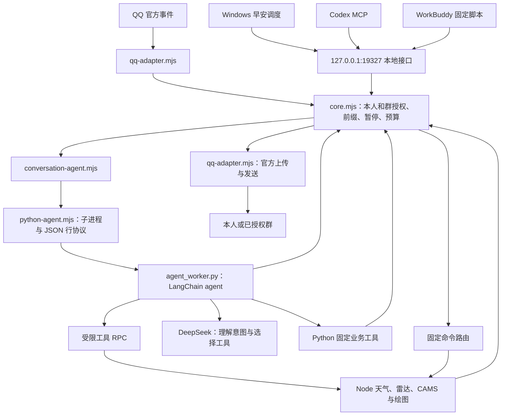
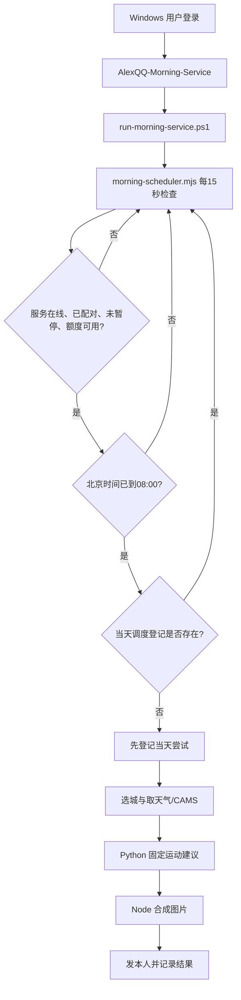

# 亚历克斯 QQ Bot 开发交接

更新日期：2026-10-29。运行工作区：`D:\Projects\Alex Bot`。本文描述本机当前代码与已核对状态，不代表云端部署或未来平台权限承诺。

推荐简图与区域补充：自然语言教室推荐现在回复一张1080px橙色简图，包含楼宇/教室、等级、当前时间、采集时间、空闲区间、等待下课标记和模型选择建议；不再把长候选列表当作最终QQ正文。模型解释失败仍按真实候选绘图。`campus_compact.py`由独立校园worker直接调用，不执行skill。`building`参数默认三号楼，本轮消息未显式提及楼宇时强制恢复默认，不继承聊天历史或模型旧参数；明确主楼、新主楼等按接口实际楼宇筛选，“学院路全部教学楼”可跨楼宇推荐。新抓取指定其他楼宇时同样返回对应简图。仍仅学院路，指定不存在楼宇/沙河时提示，不静默改成三号楼。其他楼宇不套用三号楼小教室/排除名单/邻接关系，保留原始教室名与楼宇身份。返回/绘图/发送继续校验白名单或本人权限；灰名单禁用。回归Node380项、Python122项通过，真实worker绘图及两种区域示例已检查，未发真实QQ测试消息；本轮只本地更新。

即时推荐补充：用户问“现在去哪个教室”“现在换教室”时，按服务器北京时间识别上一节有课、已经实际下课、后续连续空闲的教室，优先于普通小教室/下午整段规则，列为即时1级，其余档位顺延。同档优先小教室，课间可从已下课时刻进入；已下课不设置时间窗口；本节尚有10分钟以内结束、后续连续空闲的也为即时1级，但必须标明等到下课时刻才能进入，超过10分钟不提前加权。午间及晚间跨时段同样处理。仅session=now启用，不改全日图片和明确上午/下午/晚上的既有排序。候选just_released标志与真实时间交给无工具权限的模型解释，固定列表标注“刚下课优先”，仍不保证到场有座。补充回归Python116项、Node完整378项通过，无真实QQ测试或GitHub更新。

最新维护调整三号楼分时段优先级与橙色深浅，新增QQ抓取回执、教室缓存及基于真实北京时间的大模型推荐。白名单全业务及灰名单聊天/换算权限继续保留。最新证据见 `codex-qq-plugin/deploy/campus-memory-20261029.json`；此前群权限、校园接入及本人收图记录作历史保留。用户要求今后仅明确提出时更新GitHub，本轮只本地修改、测试和部署，规则已写入AGENTS。

## 1. 接手先看这里

亚历克斯是通过腾讯官方 QQ Bot API 运行的独立机器人。日常 QQ 客户端不需要注入、替换或第三方协议登录。Node.js 服务负责接收消息、授权和发送；Python LangChain 负责自然语言工具选择及新增业务规则。**正常聊天、查询和早安任务不依赖 Codex 开着**；Codex 仅在自己的任务需要通知时调用本地 MCP。

四条入口共用同一个 QQ 发送核心：

1. QQ 本人私聊／白名单群：固定命令或自然语言 → 查询／聊天 → QQ；灰名单群仅聊天和换算。
2. 独立早安调度脚本：北京时间08:00，晚启动补发 → 本人。
3. Codex MCP：已授权通知或手动测试 → 本人；显式授权的广播可到当前白名单。
4. WorkBuddy 自习 skill：截图分析与核对 → Python 绘图 → 本地图片接口 → 本人。

接手顺序：读本目录 `AGENTS.md` → 本文 → 对应模块 → 测试与部署记录。`codex-qq-plugin/README.md` 包含大量历史记录，旧额度、旧路由说明不能直接当成当前配置。

### 本轮维护后的运行状态

| 项目 | 状态 |
|---|---|
| QQ 服务版本 | 0.2.1（本轮维护用Git提交定位，不修改各业务发布版本） |
| QQ 连接与配对 | connected、已配对本人、未暂停 |
| 群 | 现有1个白名单保留，灰名单初始为空；实际按 groupOpenid 授权 |
| QQ 额度 | 15次/滚动分钟、300次/北京时间自然日，预留10次主动通知；普通回复上限290 |
| 增强早安 | `config/morning-report.json` enabled=true |
| Windows 任务 | `AlexQQ-Morning-Service`，本次查询为 Running |
| 聊天 | `chat-policy.md` 启用，安全输出上限600字符 |
| WorkBuddy skill | 2.3.1；标识仍为 `building3-study-planner-v2-1`；校园链路直接复用Python规划/绘图，不执行skill |
| 学院路空教室 | 单独加密校园配置、固定JSON查询、三号楼图片；本人私聊及白名单群主动查询可用 |
| 云端 | 未部署；电脑关机、休眠或断网不保证服务与投递 |

前次并发控制维护运行了完整离线测试并重启服务，当时未发送QQ测试消息，重启前后计数39。本轮校园接入已另外完成一次真实本人图片测试：接口SENT，用户确认“已收到，显示正常”；计数由39增至40。服务connected、已配对、未暂停、1个白名单群、无不确定投递，没有重置计数/配对/幂等记录。原早安计划任务此前核对为Running。状态均为时点快照，接口接受与用户实际收件分开记录。

最新群权限代码已重启生效，状态新增`grayGroupCount=0`，原白名单1群保留；仍connected、已配对、未暂停、无不确定投递，发送计数重启前后均40。此轮仅离线回归和本机状态检查，未实际查询余额/校园、调用在线模型或发送QQ测试消息；新增群核心权限尚未做真实QQ收件验收。

本轮教室优先级、橙色配色、回执与缓存推荐已在本机重启生效。最终检查connected、已配对、未暂停，白名单1群、灰名单0群，无不确定投递；最终重启前后发送计数均41，测试本身未向QQ发送消息。模型推荐已用已有真实缓存在线验证，结果仅保存本机忽略目录。本轮Git只本地记录，不推送GitHub。

## 2. 总体架构与流程



模型不能直接发送 QQ、选择任意收件人、执行 shell 或读取任意文件。它只在有限工具及参数范围内决定业务动作，Node 在执行及发送阶段校验边界。图片数据留在本地链路，天气工具向模型返回简要完成信息，不把图片字节塞进模型上下文。

### 自然语言处理

1. 核验本人／已确认群；群命令必须有 `梁圣 / 梁祖 / 梁嗨 / 小难梁` 之一及空白分隔，不需要 @。
2. 固定命令先走确定性处理；自然语言进入 `conversation-agent.mjs`，检查聊天规则、预算与上下文。
3. `python-agent.mjs` 管理 Python worker，经 stdin/stdout JSON 行协议传递请求、工具调用与结果；stdout 不可混入普通调试日志。
4. `agent_worker.py` 使用 LangChain `create_agent`；参数由 Pydantic schema 约束，每个请求只允许一个工具动作。
5. 天气等通过受限 RPC 回调 Node 的 `WeatherToolbox`；换算、预算、官方状态、余额等由 Python 实现。
6. 天气／雷达成功直接输出图片；复杂换算、生活费及状态查询可在工具取得事实后追加一次**没有工具权限**的模型解释。余额结果直接输出，不交给模型续写。
7. 发送核心再次处理权限档位、暂停、目的地、发送预算及请求标识，最后调用官方接口；图片上传后、消息发送前再校验权限。

### 当前群权限（本轮用户授权）

| 入口 | 开放范围 |
|---|---|
| 已配对本人私聊 | 全部业务；既有本人管理命令 |
| 白名单群 | 所有成员带原有前缀主动询问可用全部业务，包括DeepSeek余额、学院路JSON查询与三号楼图片 |
| 灰名单群 | 基础聊天、固定单位换算；HU$/人民币、马里/长度、马时/时间、全马/半马换算均可；不开放预算及其他查询 |
| 未列入名单的群、非本人私聊 | 不开放 |

第04节选择白/灰档位生成绑定码、在目标群发送并回页确认；也可直接切换已有群或移除。两档各最多10群，不能重复归类。迁移旧状态仅补空的`grayGroups`，保留白名单、配对、暂停、额度和幂等记录；没有将现有群自动降级。日常自动任务仍只发本人，显式授权广播仍只枚举本人与白名单，灰名单不在广播范围。

可信档位由`BridgeCore`读持久名单生成，不接受QQ文字或模型参数指定；Python LangChain只绑定该档位的工具，Node再校验实际执行与返回结果。切换清理该群背景；降级或移除立即影响处理中请求，等待查询或图片上传结束后不再按旧权限发出结果。已交给QQ的消息无法撤回。余额结果直接回复、不回传模型，群背景只留“已查询账户余额”占位。旧`CAMPUS_OWNER_ONLY`错误码为兼容保留，当前含义是仅本人或可信白名单群可查询。

本轮修复：HTTP暂停（只限`paused:true`）与断开在认证、来源及JSON校验后绕过耗时操作锁；恢复发送与凭据修改仍按原规则串行。断开会取消正在等待凭据或尚未完成的连接，返回`CONNECT_CANCELLED`，避免稍后意外重新连接。暂停标志立即参与状态与发送判断；图片上传完成后、真正发消息前再核对一次。已提交给QQ平台的消息不能靠暂停撤回。

LangChain 的优势是统一工具描述、参数校验、上下文与语义路由，让“北京雷达图”“全马是多少马里”不必逐句编写关键词模板。它不是定时器，也不会自动获得网页、账户、文件或发送权限。新增业务默认按 `AGENTS.md` 使用 Python LangChain Tool，既有 Node 天气实现是保留的实现，不应为“统一语言”盲目重写。

## 3. 当前业务功能

| 功能 | 用户入口／行为 | 主要实现 |
|---|---|---|
| 天气三联图 | `发 天气 广州` 或自然语言；温度、PM2.5、逐小时降水概率，一张图无附文 | `weather*.mjs`、`locations.mjs`；LangChain `weather_image` |
| 雷达 | 单站、区域与全国拼图；北京默认大兴、天津默认塘沽；成功发官方原图 | `radar.mjs`；`radar_image` |
| 雷达目录 | 按省／站点查询与翻页 | `radar_catalog` |
| CAMS | 地点未来48小时 PM2.5 图，默认北京 | `air-quality.mjs`、`air-chart.mjs`；`air_quality_image` |
| 聊天 | 爱吃白饭的大肥鱼，限定话题下自然回复 | `config/chat-policy.md`、`reply_chat` |
| 单位换算 | HU$/人民币、马里/长度、马时/时间；支持复杂问题先算后解释 | `python/conversions.py`；`convert_units` |
| 生活费 | 已知可用余额是否撑到发薪日 | 同上；`living_cost_budget` |
| OpenAI 状态 | 泛问简报、具体服务或故障追问 | `python/openai_status.py`；`openai_service_status` |
| DeepSeek 余额 | 本人私聊或白名单群主动问，查本机已保存 API Key 的账户 | `python/deepseek_balance.py`；`deepseek_account_balance` |
| 早安报告 | 每天08:00天气三联图与运动建议，固定脚本，无需模型推理 | `morning-*.mjs`、`python/morning_report.py` |
| Codex 通知 | 执行任务的授权通知、阻塞求助；不是 QQ 任意遥控 Codex | `src/mcp.mjs`、`codex-package/` |
| WorkBuddy 自习图 | 分析截图，双栏长图发本人 | `workbuddy-study-qq/`、`src/study-briefing.mjs` |
| 学院路空教室 | 本人私聊或白名单群“查空教室”“三号楼简报”或自然语言；本机JSON与三号楼图片 | `python/campus_classrooms.py`、`campus_report.py`、`campus_worker.py`、`src/campus-*.mjs` |
| 缓存教室推荐 | “推荐晚上的教室，多推荐几个”“现在想换教室推荐去哪”；按真实北京时间取缓存候选，再由模型解释 | `python/campus_recommendations.py`、`agent_worker.py`、`src/campus-service.mjs` |

固定比例不得被提示词改变：0.6 HU$=70人民币；1马里=3.08km；1马时=1.5小时；全马42.195km，半马21.0975km。古月币没有钱包、交易或实时外汇服务。

生活费按每天50人民币、每月10日发薪，包含今天、不含发薪日；10日按已领薪计算下月。不能猜用户余额，不自动加入房租、还款或其他开销。

OpenAI 状态来自固定官方 `status.openai.com` 数据端点，缓存60秒；泛问不主动带历史事件或示例型号，用户追问再展开。官方正常不保证个人网络、账号或某个具体模型可用。

DeepSeek 余额是本机配置的 API 账户余额，不是提问者自己的任意账户、网页版订阅／QQ钱包／生活费。自然语言可由模型选择；明确“查DeepSeek余额”保留无模型备用路径。本人私聊与白名单群主动查询可用；灰名单在读取凭据前即拒绝，结果不进入普通会话记忆。

### 天气数据与图表语义

- 雷达取中央气象台公开目录和图像，动态目录不等于所有站点持续供图。超过本地60分钟时效、缺时间或无图时报告不可用。
- 天气使用 Open-Meteo ECMWF IFS；空气使用 Open-Meteo 提供的 CAMS Global。不是直接登录 ADS 下载，也不是本地空气质量监测站。
- 地点先查 `data/weather-locations.json`，再走地理编码；同名地点澄清，不默认第一个。
- CAMS PM2.5 是浓度模型预报，不是综合 AQI、能见度、实况雾霾诊断；太阳辐照不是 UV 指数。
- 所有时间按北京时间；缺数留断点，不填0。最高逐小时降水概率不是“全天降雨概率”。
- 温度用固定温标颜色；PM2.5 分段色以当前代码和来源说明为准。交接文档不重新认定外部标准是否更新，改阈值前重新核对官方来源。

## 4. 上下文、模型与发送限制

白名单及灰名单群只保留服务实际收到的最近10条、30分钟内的筛选匿名背景，不读取 QQ 历史消息。无前缀普通文字只更新背景，不调用模型；触发请求时背景会发给 DeepSeek。群之间隔离，切换名单、移除、暂停、断开或重启清理背景；筛选不保证文本绝无个人信息。

模型配置由本地页面保存，经 Windows DPAPI 加密；源码默认 model 名不代表本机当前已配置型号。不要直接把模型固定成用户曾举例的型号。当前代码设置 `temperature=0.9`、`max_tokens=768`、模型超时20秒、SDK自动重试0；worker总超时上限60秒。

仅连接失败且工具尚未执行时，middleware 最多恢复一次；鉴权、余额不足、限流、超时和已经执行的工具不能靠重试掩盖。`model_transport.py` 沿用本机系统 HTTP(S) 代理，不关闭 TLS，不在日志打印代理凭据。

模型逻辑请求预算为单人9/分钟、scope12/分钟、全局15/分钟、每日180；核验修改点见 `chat-safety.mjs` 与对应测试。复杂解释可以用两次模型推理，但按逻辑请求计预算。600字符是输出安全兜底，不是要求每句都机械短答。

QQ发送预算是另一层：当前 `config/send-limits.json` 为15/分钟、300/日、预留10通知。本人、群、日报及广播共享；广播每个目标分别计数。不要把历史的20/日、200/日当腾讯官方额度。本地放宽不能解除腾讯侧限制。

## 5. 早安自动任务



这是**用户登录启动**的任务，不保证停留在系统登录界面时运行。08:00前启动等待，之后启动／恢复且当天尚未登记则补发。服务不可达时调度器最多每5分钟尝试启动；不解除发送暂停。

调度登记 `.private/morning-scheduler/日期.json` 与核心 `weather-daily-YYYY-MM-DD` 是两层保护；实际登记后失败或送达不确定不自动补发，不能因改版清记录。WorkBuddy“每次调用都发”不影响日报规则。

增强版当前开启，`scripts/enable-morning-report.ps1 -Disable` 可回退旧北京日报；切换不改变当日登记。日常仅发本人，群不自动订阅。

选城依 `data/holidays-cn.json`：官方放假区间内（含区间内周末）天津，其余北京，普通周末不切天津。未知年份默认北京并提示日历待更新。2027资料应在接手时重新核对，不能沿用旧文档“尚未发布”当实时事实。

正常工作日周一、三重点20–22点；其他日期候选07–08:30、16–19、20–22点。按生成时刻剔除已过时段，选择连续30/60分钟；温湿度、降水、PM2.5、风、辐照及天气码按确定性规则评估。评分是产品自定义适宜度，不是官方或医疗结论。

## 6. WorkBuddy 接入与2.3.1行为

源目录：`workbuddy-study-qq/skills/building3-study-planner-v2-1`。
本机安装：`C:\Users\Alex\.workbuddy\skills\building3-study-planner-v2-1`。
安装包：`workbuddy-study-qq/building3-study-qq-2.3.1.zip`。


`run.ps1` 默认额外生成未核对预览；正常查询核对后由 WorkBuddy 执行 `publish.ps1 -Reviewed`，`-NoSend` 只生成，`-Demo` 明示模拟。完整聊天报告不应被图片替代。

固定绘图：1800px双栏、陶土橙／暖白；左侧空闲绿、有课白、未知黄，大行距和时段分界；晚间时段标题写19:00起、常用19:50起。具体建议保留可核验课节范围，不推定晚间无限使用。

按用户最新口径：上午和晚上，小教室连续空闲为1级、普通教室2级、换房3级、局部4级，不按前一节是否有课再拆档。下午第5节明确有课且第6–10节整段空闲为1级，同档优先小教室；其他小教室整段2级、普通教室整段3级、换房4级、局部5级。第5节未知不视为有课。先排序后截取5条，同档晚间优先11–14完整覆盖。原橙色系保留，1级底色`#edb17d`、2级`#fbe3ca`，明暗差加大；不更改排除教室、原始课节和未知语义。Bot直接复用本仓库函数，未执行skill或同步本机已安装的WorkBuddy技能副本。

**2.3.1取消按内容跨调用去重**：每次明确调用发送器产生新的随机 `study:<64hex>` 请求标识，相同日期、截图或PNG也会发送；manifest里的旧内容摘要仍保留，但不是实际POST的发送身份。每次调用只POST一次，超时不自动重试；下一次用户明确调用是新的发送。

`.qq-delivery` 保留每次请求回执，不因旧记录拒绝新调用。不应删除回执或把这种行为扩展到早安任务、Codex通知。QQ核心仍保留单次请求标识保护和配额。

图片发送只读本机访问口令用于固定回环接口，不把口令写入输出。manifest必须已核对、日期合法、生成不超过2小时、SHA256与PNG匹配、PNG不超过1.5MB。服务额外限制请求大小、PNG签名及真实解码、1080/1800宽、200–16000高；接口不接受文件路径、远程URL或收件人。

WorkBuddy原脚本仍由其自带Python执行OCR与绘图，Bot `.venv` 执行LangChain发送。本轮校园接入另外把Pillow与Playwright加入Bot专用环境，使Bot能直接调用三号楼规划/绘图函数；没有调用skill、OCR或WorkBuddy应用。依赖已写入Python入口和锁文件。

本轮只更新源目录陈旧测试与README，发送器行为仍为2.3.1，没有重发安装包或修改已安装skill。源目录与已安装`send_qq.py`的SHA256核对一致。发送测试覆盖同manifest两次独立POST、超时单次POST及回执、暂停/离线/额度拒绝、未核对与图片篡改；分别在Bot与WorkBuddy的现有环境运行，避免因缺少另一环境依赖而跳过验证。

## 7. 本地接口、插件与文件地图

服务监听 `127.0.0.1:19327`，UI `/`，开发说明页 `/guide`，公开健康检查 `/health`。`/api/*` 有本机认证与来源校验；不要在日志或交接文档写访问口令、带口令的设置URL。

| 接口组 | 用途 |
|---|---|
| GET `/api/status` | 安全状态，配对、连接、额度及agent状态 |
| `/api/config`、`/api/agent/config` | QQ凭据与模型配置；敏感值仅本地输入 |
| `/api/connect`、`/api/disconnect`、`/api/pause` | 生命周期与暂停 |
| `/api/pair/*`、`/api/group/*` | 本人及白/灰名单绑定；`group/access`切换档位，`group/remove`移除 |
| `/api/notify` | 已授权本人文本通知 |
| `/api/notify-all-allowed` | 显式授权后枚举当前本人和白名单广播 |
| `/api/weather/preview`、`/api/weather/briefing` | 天气预览、daily或test发送 |
| `/api/morning/preview`、`/api/morning/test-all-allowed` | 增强报告预览或显式广播测试 |
| `/api/study-briefing` | WorkBuddy本人PNG发送 |
| `/api/campus/config`、GET `/api/campus/status` | 单独的校园加密设置及不含账号密码的状态 |
| `/api/campus/query`、`/api/campus/login` | 固定JSON查询；可见专用浏览器供本人完成验证码/二次验证 |
| `/api/campus/briefing` | 查询、生成三号楼图片、向本人发送一次；调用方提供本次requestId去重 |

MCP源码注册 `qq_status`、`qq_notify`、`qq_weather_preview`、`qq_weather_briefing`、`qq_broadcast`、`qq_morning_test`。安装缓存是否已加载以当前工具列表为准；只修改源码不会保证旧聊天立即刷新MCP。

| 文件／目录（相对QQ项目） | 责任 |
|---|---|
| `src/server.mjs` | HTTP路由、认证及组件装配 |
| `src/core.mjs`、`src/access-policy.mjs` | 配对、群白/灰名单、入站及工具权限、发送队列、预算和状态 |
| `src/qq-adapter.mjs` | 腾讯SDK事件、上传及发送 |
| `src/storage.mjs` | DPAPI、受限目录、原子持久化 |
| `src/conversation-agent.mjs`、`chat-safety.mjs` | 自然语言边界、模型请求预算及上下文 |
| `src/python-agent.mjs`、`python/agent_worker.py` | Node/Python协议及LangChain运行 |
| `src/agent-config.mjs`、`python/model_transport.py` | 模型配置与网络客户端 |
| `src/weather-tools.mjs`、`weather-commands.mjs` | 固定天气工具与命令入口 |
| `src/morning-*.mjs`、`python/morning_report.py` | 日历、分析、早安图表 |
| `src/mcp.mjs`、`bridge-client.mjs` | Codex与回环接口桥接 |
| `config/` | 发送额度、早安开关、聊天话题与人设 |
| `data/` | 地点目录、节假日日历等非密钥数据 |
| `public/` | 控制页、guide、logo |
| `codex-package/` | Codex本地插件安装源；不要打包整个运行目录 |
| `deploy/`、`test-output/` | 验收记录、测试日志、预览；不是一律可公开的安装素材 |
| `.private/` | 凭据、身份与运行状态，禁止提交或拷入安装包 |

## 8. 启动、开发与验证

本机Node：`D:\Program Files\nodejs\node.exe`；要求Node≥22。
Bot Python：`D:\Projects\Alex Bot\codex-qq-plugin\.venv\Scripts\python.exe`。
WorkBuddy Python：`C:\Users\Alex\.workbuddy\binaries\python\envs\default\Scripts\python.exe`。

```powershell
Set-Location -LiteralPath 'D:\Projects\Alex Bot\codex-qq-plugin'
# 日常入口，打开本机控制页；桌面“亚历克斯 Bot”快捷方式使用它
.\scripts\open-console.ps1
# 独立启动／停止服务
.\scripts\start-service.ps1 -AutoConnect
.\scripts\stop-service.ps1
# 只读检查计划任务
Get-ScheduledTask -TaskName 'AlexQQ-Morning-Service'
# 离线Python测试
.\.venv\Scripts\python.exe -m unittest discover -s python -p 'test_*.py'
# 完整Node离线回归，可与正式服务同时运行
npm test
# 模拟早安图，无QQ发送
node scripts/preview-morning-local.mjs
```

依赖恢复：Node用`npm ci`，Python优先检查 `scripts/install-python-agent.ps1` 与 `python/requirements*.txt`，保持虚拟环境隔离。安装自启动见 `scripts/install-autostart.ps1`，不要在不需要时重复创建任务。

MCP测试已改用系统分配的回环临时端口，子进程通过测试代码注入受信任客户端；可以在正式服务占用19327时执行完整`npm test`。正式MCP仍固定默认19327，不新增任意URL、主机、环境变量端口或工具参数。其他临时服务测试同样使用独立端口。

WorkBuddy测试在`workbuddy-study-qq`目录运行：Bot环境执行`-m unittest test_briefing.SenderTests`（4项），WorkBuddy环境执行`-m unittest test_briefing.BriefingTests`（1项）。只用模拟发送接口和本地渲染，不发送真实QQ消息。

新功能推荐流程：

1. 阅读AGENTS及对应模块，确认输入、工具权限、输出和失败语义。
2. Python实现确定性业务与受限LangChain Tool；Node只添加必要桥接与输出校验。
3. 增加缺数、歧义、权限隔离、超时和错误路径测试，勿只测试成功例子。
4. 本地预览、人工看图；明确需要时才调用真实模型、数据源和QQ。
5. 备份变更文件；同步源码、安装副本、元数据及ZIP，检查hash和版本；不要覆盖用户其他任务改动。
6. 重启影响到的服务并查状态。记录测试环境、命令、结果、未覆盖项；平台接受和客户端确认分开记录。

## 9. 本轮修复与后续优先级

最初审阅见`codex-qq-plugin/deploy/codex-review-20261029.json`；以下是本轮处理结果，以维护记录和当前源码为准。

| 优先项 | 证据与影响 | 建议 |
|---|---|---|
| HTTP全局操作锁 | 已修复：暂停/断开绕过慢操作锁，取消晚到连接，上传后复核暂停；相关并发回归通过 | 当前运行服务已重启加载，已发往QQ的请求不能撤回 |
| 全量测试端口冲突 | 已修复：MCP测试注入回环随机端口，在线服务19327持续运行时全量通过 | 测试端口不进入公共工具schema或正式环境配置 |
| WorkBuddy源目录测试陈旧 | 已修复：测试按2.3.1每次明确调用新发的规则重写，4项发送、1项绘图通过 | 保留单次超时不重试，不恢复跨调用内容去重 |
| 文档漂移 | 已更新WorkBuddy版本、QQ当前额度/余额路由说明、本交接与根README；旧验收按时间保留 | 以后发布同时更新行为、证据与待验项 |
| 版本控制 | 已建立工作区根Git仓库；源码与非密钥配置纳入管理 | `.private`、浏览器profile、备份、回执、ZIP与隐私样本保留本地 |
| 持续运行验收 | 历史人工测试不等于跨夜、休眠恢复或长期无互动投递成功 | 用真实调度记录与本人收件反馈验收，不循环补发 |

本轮回归Node378项、Bot Python111项、共享WorkBuddy绘图/发送5项全部通过，无跳过；覆盖新优先级、当前时间过滤、回执失败/暂停/额度不足时不爬取、缓存持久化恢复与上限、越权拒绝、无工具模型解释、编造教室/时间回退，并保留前次全部权限回归。橙色版式另做图片目视检查。在线验证使用已有缓存，两个用户示例都正确选择缓存工具并完成大模型解释，分别列出10和8个候选，带真实当前时间和采集时间；未重新抓取、未查询余额、未发QQ。早期验证有模型连接波动并回退真实列表，后续两例通过，不能保证未来供应商始终在线。此前校园JSON和本人图片的真实收件验收见第10节；本轮两阶段QQ投递仅离线模拟，长时间运行与休眠恢复仍待独立验收。

### 常见排障顺序

| 现象 | 首先检查 |
|---|---|
| 所有消息不回 | `qq_status`：连接、暂停、配对、额度；再看服务进程 |
| 群不回、私聊正常 | 实际群授权、前缀空白、接收全部消息与主动发送权限 |
| 固定雷达能回，自然语言失败 | 模型配置／Key状态、Python worker、代理路径、模型错误码与请求预算 |
| WorkBuddy只有本地图片 | 是否执行publish -Reviewed、manifest新鲜度、发送回执、实际加载的skill版本 |
| WorkBuddy旧版DUPLICATE | 旧发送器按内容去重；当前2.3.1每次新调用已修正，不删除服务器记录 |
| 早安没到 | 用户是否登录、任务是否运行、联网与暂停、当天是否已登记、日期与额度 |
| 测试EADDRINUSE | MCP已用独立临时端口；检查其他测试或旧代码副本，不停止不相关进程 |
| SENT却未看到 | 区分接口接受与QQ客户端实际收件，不换标识循环重发 |

## 10. 学院路查询、校园凭据与迁移边界

`buaa-classrooms/` 保留最初独立采集原型。当前Bot生产链路位于`codex-qq-plugin/python/campus_classrooms.py`：真实LangChain Tool固定查询学院路全部教学楼，参数仅date（今天至未来7天），成功和失败都返回`buaa-classrooms.v1` JSON。本人私聊及白名单群主动自然询问可选校园工具；固定命令“查空教室 [YYYY-MM-DD]”“三号楼简报 [YYYY-MM-DD]”无需模型Key。灰名单禁用；Node在实际执行和返回时再次校验可信档位。

**按2026-10-29用户明确指定的口径**：接口`kxsds`列出的节次为空闲，其余1–14节为有课；不额外按当前时刻删改接口空闲标记。JSON的`free_periods`与`busy_periods`完整划分14节，绘图F/B使用同一数据。此约定取代前次交接建议的未知格映射，不更改WorkBuddy截图输入本身的F/B/?规则。

校园学号和密码由用户自行在控制页第06节输入。`CampusConfigStore`将两者连同enabled用Windows DPAPI CurrentUser整体加密，保存在`.private/campus-config.json`；状态和配置响应只返回configured/enabled，不回显账号或密码。两项留空保留旧值，修改任一项须提供完整新账号密码。校园凭据只经本机stdin管道交给独立校园worker，绝不放进自然语言worker、模型提示词、命令行参数或Git。

校园worker使用本机Edge专用profile，位于受保护的`.private/campus-browser/`；认证会话与学号密码都不上传。只允许HTTPS北航域名资源，且只在`sso.buaa.edu.cn`已核对的登录输入框使用保存的凭据，每次查询最多自动提交一次。遇验证码/二次验证返回`CAMPUS_INTERACTION_REQUIRED`，由用户在配置页打开可见浏览器自行完成，不自动识别或绕过。不同凭据使用不同profile，避免换账号后沿用旧会话。

JSON保留学院路全部楼宇/教室；图片只筛选三号楼，直接导入`plan.py`及`briefing_layout.py`，采用上述最新分时段优先级、排除名单、推荐理由和双栏版式，增加来源及获取时间。没有执行SKILL.md、OCR、WorkBuddy进程或旧发送器。最新JSON保存在`.private/campus-output/latest.json`，图片为同目录内部随机ID的PNG；这些课堂数据文件受目录权限保护、不进入Git。固定JSON可在本机控制页查看和下载。QQ本人/白名单发起新抓取时先回复“正在抓取数据”，成功再向原会话发一张图片；配置页发送按钮仍只发本人。

回执仅在选中校园抓取工具后发送，固定命令无需先调用模型。`BridgeCore`提供不可序列化、无任意收件人或文字参数的progress回调；回执和最终结果使用不同持久幂等键，各计一次发送，预检需足够两次普通回复额度。回执失败、不确定、暂停或降级后不开始爬取；回执本身不进入群背景。已交给QQ的消息不能撤回。查询失败可在回执后返回固定错误JSON，不编造图片。

每次成功采集更新内存及`.private/campus-output/memory.json`，按日期替换、最多8天的快照；重启可恢复，旧版可从latest.json加载。图片渲染失败时仍缓存已成功获取的数据。`python/campus_recommendations.py`提供只读LangChain Tool：日期默认今天，session仅now/morning/afternoon/evening，默认8项、上限12，exclude_room仅三位教室号；时钟来自Node，消息和模型不能提供或篡改now。只使用对应日期、24小时内的快照，附采集时间；过期、无缓存、已结束时段或无候选时如实说明，不自动重新登录。空闲仍按原始接口记录；时间过滤仅影响推荐，不改JSON或全日图片的空闲标记。

“推荐一下晚上的教室，多推荐几个”“现在我想换教室，推荐去哪”等由既有agent选`buaa_classroom_recommend`，受限RPC取缓存候选，再走独立campus_advice模型解释（tools=[]）。大模型仅收到筛选后的候选、等级、可用时间和采集时间，不接触校园凭据、完整教室表或任意文件。代码始终输出真实候选列表，说明文字若出现未提供教室/时间、占座保证等即舍弃；模型连接/解释失败保留可核实的列表。本人和白名单可用，灰名单在缓存读取前拒绝，返回和发送时再次核验权限。缓存只含共用课表事实，不包含各群或个人聊天背景；聊天上下文继续隔离。

校园浏览器查询在独立worker执行；公共模型worker默认60秒，仅已识别的校园RPC延长到120秒；可见浏览器验证单独最多约3分钟。相同专用profile不并发查询，失败不以旧JSON冒充当前数据。图片发送经BridgeCore校验配对、名单档位、暂停、限额及单次请求标识。仅回复主动请求，不新增自动群推送。

真实验收：用户在第06节自行填写并加密保存凭据后，首次查询遇到登录iframe跳转竞态，返回固定错误JSON，未发送图片。通过只含阶段/错误类型的诊断定位并修复；回归补测正常跳转、认证失败和验证码分支。修复后2026-10-29 15:24:55（北京时间）真实查询成功：学院路158间教室，其中三号楼45间，另外为主楼与新主楼；JSON为`buaa-classrooms.v1`，图片按规则排除8间后纳入37间。本人图片仅发送一次，接口SENT，用户在本聊天确认“已收到，显示正常”。不据此声称验证码/二次验证已实际触发验收或QQ自然语言已做真实在线模型测试；这些分支仅离线模拟覆盖。

本轮凭据由用户自行输入，开发过程未读取输入框、未输出真实学号密码。临时诊断只保存固定阶段与异常类型，绝不保存异常全文或登录请求。完整真实教室JSON、图片、请求回执和诊断仅保留本机`.private`/`test-output`，仓库只有脱敏验收摘要。

尚无云端部署。迁移需重新确认QQ权限、定时任务、网络与认证存储；Windows DPAPI材料不能直接当跨机器可用密钥。迁移时调整绝对路径及统一的 `QQ_BRIDGE_HOME`，先验证单实例，避免本地与云端同时连接和重复调度。

Codex阻塞求助遵守最新AGENTS：至少三次有效诊断、已问具体问题且等待五分钟仍无响应、状态允许时仅通知一次。用户取消或问题解决即停止；不是脱离Codex运行的后台监控。WorkBuddy的重复发送规则不覆盖该约定。

## 11. 证据与维护

- 当前业务源码与配置：`codex-qq-plugin/src/`、`python/`、`config/`。
- 最近审查：`codex-qq-plugin/deploy/codex-review-20261029.json`。
- 本轮修复及离线/重启验收：`codex-qq-plugin/deploy/maintenance-20261029.json`。
- 校园接入、真实采集/本人收图及新增回归：`codex-qq-plugin/deploy/campus-integration-20261029.json`。
- 白名单全业务与灰名单聊天/换算权限、最新回归与部署快照：`codex-qq-plugin/deploy/group-tiers-20261029.json`。
- 三号楼新优先级、橙色明暗、抓取回执、缓存推荐及在线模型验证：`codex-qq-plugin/deploy/campus-memory-20261029.json`。
- 真实验收历史：`deploy/langchain-live-verification.json`、`enhanced-morning-live-test.json` 等；结论限于各次记录。
- WorkBuddy实际规则：已安装及源目录的 `SKILL.md`、`references/qq-briefing.md`、`scripts/send_qq.py`。
- 备份：项目根 `backups/`。含运行文件与用户内容的备份不得默认公开。

每次发布请更新本文的日期、版本、变更行为、部署副本及验证状态。不要把凭据、本人或群的完整平台标识、带授权参数URL、校园profile或完整聊天日志写进交接资料。

## 12. Git与GitHub交付

按用户最新要求：仅在明确要求更新GitHub时才推送或修改远端，已写入本目录AGENTS。教室优先级/缓存这一轮只本地修改、测试、部署及Git记录，没有推送；此前远端版本包含群权限功能，不能认为自动包含本轮改动。

仓库：[Alexx-Powered/alex-bot](https://github.com/Alexx-Powered/alex-bot)。2026-10-29新建并查询API核实为PRIVATE；默认分支main，origin指向该仓库。本地Git根目录是`D:\Projects\Alex Bot`，统一管理QQ主服务、WorkBuddy扩展、教室采集原型及交接资料。作者采用GitHub账号的noreply邮箱。

提交区分原始源码基线和本轮修复，后续用`git log`定位维护版本。旧版服务号仍为0.2.1，不用它判断是否包含本次修复。

根`.gitignore`排除所有`.private`、校园`.private-profile`、`.qq-delivery`、备份、依赖/虚拟环境、预览、运行日志、ZIP、真实采集样本及原始验收记录。这些本机文件保留不动。仅经过筛选的初始审阅与本轮维护摘要进入Git；`deploy`中其他原始证据及`test-output`在远端克隆中不存在。文中引用的安装ZIP和采集样本同样属于本地材料，不能声称远端仓库包含它们。

上传前检查了跟踪文件路径与常见凭据特征；命中的测试凭据为明确合成值。后续每次提交仍需检查暂存区，private并不能替代凭据保护。改可见性、迁移登录材料或新增对外部署需另行授权与验证。
