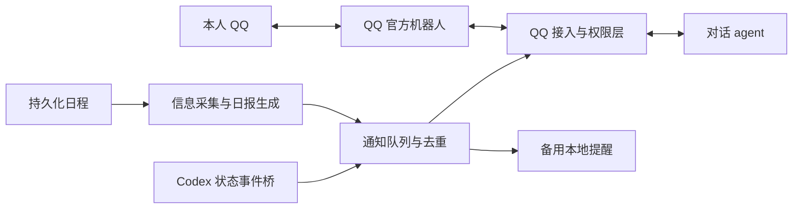

# QQ 机器人项目调研与选型

调研日期：2026 年 10 月 28 日。目标工作区：D:\Projects\Alex Bot。

目标是做一个能对话、按要求每日汇报信息、接收 Codex 任务异常通知的私人助手，同时尽量降低账号风险，不改动日常使用的 QQ 客户端。本阶段只做公开资料和源码调研，没有安装插件、登录机器人、发送消息或创建定时任务。

**建议先验证腾讯官方 dsh-qqbot；长期架构把 QQ 通知通道与 agent、调度器分开。** NoneBot2 仍是可用的定制框架，并没有因为年代早就失去价值。NapCat、LLBot、SnowLuma 等普通账号接入只列为备选研究路线。官方插件的重点风险和验证方案见[专项报告](<D:/Projects/Alex Bot/官方DSH QQ Bot风险与验证方案.md>)。

## 先区分三个层次

| 层次 | 负责什么 | 代表项目 |
| --- | --- | --- |
| QQ 接入 | 认证、收消息、发消息、处理平台限制 | QQ 官方 API 与 SDK；NapCat；LLBot；Lagrange；SnowLuma |
| 机器人或 agent 应用 | 对话、记忆、工具、插件、管理面板 | DSH + dsh-qqbot；NoneBot2；Koishi；AstrBot；LangBot；MaiBot；Aurabot |
| 可靠任务服务 | 日程持久化、执行状态、通知去重、失败恢复 | 后续独立设计的 scheduler、outbox、事件桥 |

OneBot、Milky、Satori 是应用和接入端之间的协议，并不是腾讯的官方授权标志。用 NoneBot2 不等于一定要登录普通 QQ 号；它可通过官方 QQ 适配器接开放平台。反过来，把 NapCat 换成另一个 AI 应用，也不会消除下层个人协议接入风险。[NoneBot2](https://github.com/nonebot/nonebot2)、[官方 QQ 适配器](https://github.com/nonebot/adapter-qq)、[LLBot 层次说明](https://luckylillia.com/guide/introduction)

## 社区应用与框架

下列版本是调研日可见的版本证据，不是兼容性或稳定性保证。许可证描述针对所链接项目；插件、模型和其他依赖另有许可。

| 项目 | 定位及维护证据 | 许可 | 对本需求的判断 |
| --- | --- | --- | --- |
| [NoneBot2](https://github.com/nonebot/nonebot2) | Python 异步框架；[v2.5.0](https://github.com/nonebot/nonebot2/releases/tag/v2.5.0) | MIT | 适合长期自建；日报、权限、重试和通知逻辑可精确控制，agent 需另接 |
| [Koishi](https://github.com/koishijs/koishi) | TypeScript 插件框架；[4.18.11](https://github.com/koishijs/koishi/releases/tag/4.18.11) | MIT | 适合偏 TS 和可视管理的实现；并非现成完整任务 agent |
| [AstrBot](https://github.com/AstrBotDevs/AstrBot) | AI 与 IM 平台，MCP、Skills、知识库、WebUI；[v4.29.3，10 月 24 日](https://github.com/AstrBotDevs/AstrBot/releases/tag/v4.29.3) | AGPL-3.0 | 功能体验验证优先候选；QQ 接入方式仍需单独选择 |
| [LangBot](https://github.com/langbot-app/LangBot) | 对话、知识库、工具与工作流编排；[v4.11.2](https://github.com/langbot-app/LangBot/releases/tag/v4.11.2) | Apache-2.0 | 适合多信息源日报和后续多平台扩展 |
| [MaiBot](https://github.com/Mai-with-u/MaiBot) | 人格化“群友”式 AI；[v1.3.17](https://github.com/Mai-with-u/MaiBot/releases/tag/v1.3.17) | GPL-3.0 | 偏自然社交与陪聊；准确调度、审批告警不是本次首选方向 |

这些应用能否主动发消息、在特定群中收消息，最终取决于所选 QQ 接入端及平台权限，不能只看上层应用的功能清单。

## DSH 与大肥鱼相关项目

“大肥鱼”在不同项目里可能是人格、界面主题或机器人名，不能据名字判断使用哪种 QQ 接入。

| 项目 | 真正的接入方式 | 现状与适合程度 |
| --- | --- | --- |
| [腾讯 dsh-qqbot](https://github.com/tencent-connect/dsh-qqbot) | 官方 Bot API，AppID/AppSecret 与 WebSocket，连接 DSH agent | MIT；[更新日志 0.5.4，2026-10-28](https://github.com/tencent-connect/dsh-qqbot/blob/main/CHANGELOG.md)。本次重点，详见专项报告 |
| [Aurabot](https://github.com/accomplish07zrh-eng/dsh-aurabot-qq) | 普通 QQ 号 → SnowLuma / OneBot v11 → DSH | 标题为“住在 QQ 里的大肥鱼”；自身 MIT，版本字段 1.0.5。有人格、记忆、主动搭话等，通用日报需扩展 |
| [qq-bridge](https://github.com/Derpyu520/qq-bridge) | SnowLuma / OneBot v11 → 独立桥进程 → DSH Web API | 自身 MIT；README 标 v0.2.1-r1。可研究审批转发和会话桥接，链路及版本耦合较多 |
| [dafeiyu-bot](https://github.com/SAKURAfan1023/dafeiyu-bot) | NapCat / OneBot 11 → 独立 AI 陪聊程序 | MIT；README 有 v0.2.0-beta.1，Windows 通过 WSL2 Web，Windows 实机验收仍有待完成项；不是 DSH 插件 |
| [dsh-chonky-fish](https://github.com/N5Tar/dsh-chonky-fish) | DSH 聊天面板、主题与 preset | README 未提供 QQ 接入；不能拿它作为通知桥。它的 preset 权限设置也需另行审查 |

Aurabot 有保护主号的设计，但它仍会通过 SnowLuma 注入 QQ 进程。README 描述了先识别账号、只注入机器人号、注入后再次核验及关闭自动注入的流程；遇到唯一无法识别账号的进程时，还存在先接入再核验的分支。因此适合描述为“有防误接措施”，不能承诺“绝不影响日常 QQ”。[Aurabot README](https://github.com/accomplish07zrh-eng/dsh-aurabot-qq#设计要点)

SnowLuma 明确采用非商业的源码可见许可，并说明它不是 OSI 开源许可，原生附加组件还属于专有组件。其 EULA 也有账号受限和封禁风险说明，部分打包、部署及分发用途需单独授权。Aurabot 或 qq-bridge 自身的 MIT 许可不覆盖这层依赖。[SnowLuma README](https://github.com/SnowLuma/SnowLuma)、[EULA](https://github.com/SnowLuma/SnowLuma/blob/main/EULA.md)

## 普通 QQ 账号接入端

| 项目 | 调研日状态 | 客户端关系 | 本次定位 |
| --- | --- | --- | --- |
| [NapCatQQ](https://github.com/NapNeko/NapCatQQ) | [v4.18.41，2026-10-21](https://github.com/NapNeko/NapCatQQ/releases/tag/v4.18.41)；源码公开，但混合许可及额外限制，不能概括为宽松开源 | 通过 QQ 底层模块收发；Shell 可独立启动，亦有 Docker 方案 | 生态广，但仍是非官方个人账号接入 |
| [LuckyLilliaBot / LLBot](https://github.com/LLOneBot/LuckyLilliaBot) | [v8.3.2](https://github.com/LLOneBot/LuckyLilliaBot/releases/tag/v8.3.2)；GPL-2.0 | 当前同时提供 PMHQ Hook 与不依赖 QQ 客户端的纯协议模式 | 值得与 NapCat 比较，不能再只理解为旧 LLOneBot 客户端插件 |
| [Lagrange.Core V2](https://github.com/LagrangeDev/Lagrange.Core) | README 明确 V1 sunset；当前 V2 的 HTTP 接入为 Lagrange.Milky；当前分支许可待核验 | 独立 NTQQ 协议实现 | 偏协议研究与 .NET 集成；不照搬旧 Lagrange.OneBot 教程 |
| [SnowLuma](https://github.com/SnowLuma/SnowLuma) | 源码可见非商业许可，加专有原生组件 | 附加至 QQ 进程，提供 OneBot 等能力 | Aurabot / qq-bridge 的依赖，需同时评估客户端影响与许可 |
| [go-cqhttp](https://github.com/Mrs4s/go-cqhttp) | README 明确因协议变化无力继续维护；最新可见正式版 v1.2.0；AGPL-3.0 | 旧个人协议路线 | 不作为新项目基础 |
| [Mirai](https://github.com/mamoe/mirai) | 最新可见正式版 [2.16.0](https://github.com/mamoe/mirai/releases/tag/v2.16.0)，发布于 2023 年；AGPL-3.0 | QQ Android 协议库 | 旧生态参考价值高，新项目不优先；不据版本旧就断言已正式停更 |

NapCat 的 Shell 形态可以脱离日常 QQ 窗口独立运行；LLBot 无头模式已经不需要 QQ 客户端。但“不改主 QQ 进程”和“账号免受限制”是两个不同条件。NapCat 自己还提醒，同 IP / 设备上的机器人与常用账号可能受到关联影响。VM 或独立机器可用于运行环境隔离，不能当成防封技术。[NapCat 原理](https://napneko.github.io/guide/napcat)、[NapCat 安全说明](https://napneko.github.io/other/security)、[LLBot 安装说明](https://luckylillia.com/guide/choice_install)

## 官方路线现在值得重新评估

2026 年现网文档已经支持个人开发者使用官方机器人，以及 WebSocket / Webhook 两种接入。WebSocket 适合个人单机，不要求为了接事件专门开放公网服务；个人认证和公开服务的权限有差异，先用本人内部体验范围即可。[官方接入指南，页面更新 2026-10-21](https://bot.q.qq.com/wiki/)

官方当前文档已列出单聊、群聊主动消息接口及配额。日报和任务异常通知具备可验证的 API 路径，但用户允许主动消息、应用权限、接收关系、频控仍是前提。旧 GitHub 文档曾写 2025 年关闭主动推送，不能直接拿它否定当前能力。[消息收发概述](https://bot.q.qq.com/wiki/develop/api-v2/server-inter/message/overview.html)

如果后续要自建网关，可评估腾讯的 [qqbot-nodejs](https://github.com/tencent-connect/qqbot-nodejs)（MIT，Node.js 20 及以上）、[botpy](https://github.com/tencent-connect/botpy)（MIT）与 [botgo](https://github.com/tencent-connect/botgo)（Apache-2.0）。SDK 提供协议调用，不自动具备日报调度和可靠投递系统。旧 SDK README 与现网文档冲突时，以当前接口文档和实测为准。

## 建议的产品结构

以下为后续设计建议，尚未实施。

对话入口初期可直接使用 DSH 官方插件。日报与告警应通过固定接收人、明确事件类型的通知队列投递，避免每发一个状态都启动完整 agent。后续如改用 NoneBot2 或别的模型，调度和通知记录可以保留。

建议任务记录至少包含时区、下次执行时间、信息源、接收人、最近结果及幂等键。默认时区为 Asia/Hong_Kong。电脑睡眠、关机或断网会影响本地定时任务；要做到每日可靠汇报，需要持续运行的主机，或明确补发规则。

建议只把“需用户处理”“最终失败”“恢复成功”和用户订阅的摘要送到 QQ。可自动恢复的一次搜索失败无需立即打扰；重复错误合并，过期日报按规则丢弃或标注补发。

## Codex 通知的接入边界

官方 dsh-qqbot 服务的是 DSH 会话，装好它并不会自动订阅现有 Codex 桌面任务。

OpenAI 当前文档提供 PermissionRequest、PostToolUse、Stop 等生命周期 hooks。可将需要处理的事件送到本地通知服务；PostToolUse 中一次命令失败不一定代表任务最终失败。通知 hook 应快速入队、保留正常审批流程，不依赖读取易变化的聊天日志格式。[OpenAI Hooks](https://learn.chatgpt.com/docs/hooks)

如果未来让一个受控执行器运行 Codex，可以通过 app-server 的审批请求和 turn/completed 状态收集事件；该能力不能等同于“任意新进程自动监听全部现有桌面聊天”。部署时必须验证目标客户端支持和事件覆盖范围。[OpenAI App Server](https://learn.chatgpt.com/docs/app-server)

首版 QQ 只展示脱敏状态和需要用户采取的动作，审批仍在 Codex 完成。后续若做 QQ 内远程审批，需要绑定真实发送者、请求 ID、有效期和一次性决策，不能把普通聊天中的“同意”直接变成执行权限。

## 选型顺序与下一步

1. **官方 dsh-qqbot**：先验证仅本人私聊、隔日主动发送、拒收后停止发送，以及日常 QQ 客户端是否保持正常。专项报告列出了配置和源码风险。
2. **独立通知服务**：建立确定性的日报和告警投递，先发模拟事件，再接入真实任务；不依靠自由聊天决定是否要发送。
3. **NoneBot2 / 官方 SDK**：当需要精确控制日程、队列、权限和恢复策略时，用于长期自建。
4. **AstrBot / LangBot**：作为上层 agent 体验与工作流能力的对照。
5. **NapCat / LLBot / Aurabot 等**：只有官方能力确实不足，并且能接受个人协议路线风险时，再在独立实验环境评估。

没有可靠公开数据支持为这些项目给出精确封号率。当前选择依据是接入机制、平台规则和项目可核验实现；“使用的人多”“有小号”“Docker 运行”“每天只发一条”均不是免封承诺。

