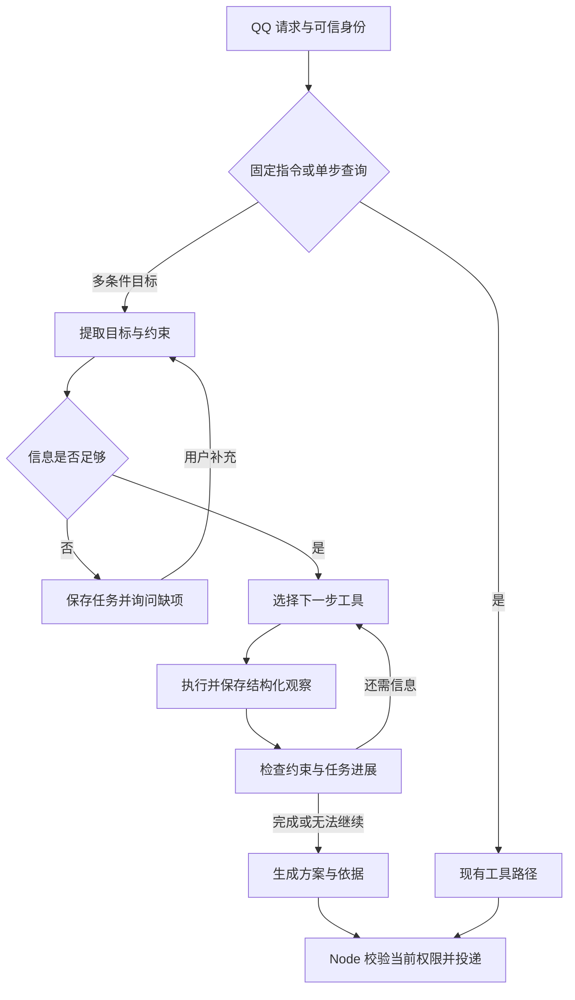

# Agentic QQ Bot 能力升级与面试交付计划

日期：2026-11-06。状态：后续开发计划，本文中的新增能力与验收目标均未完成。Milvus 的具体实现见[记忆与知识检索开发交接](milvus-memory-plan-20261106.md)。

优先交付一个能完成多条件自习规划、接受条件修改、处理数据缺失并恢复中断任务的 Agent。用同一批任务比较当前路由、固定工作流和新 Agent，让面试官看到任务完成能力、工程取舍和改进证据。

## 为什么当前项目还可能被认为简单

项目已有官方 QQ 接入、真实数据采集、图文视频交付、记忆、MCP、ECS 和 LangSmith。它们证明了应用工程的完整性，但对 Agent 决策与任务执行能力的证明仍有限。

[agent_worker.py](../python/agent_worker.py) 的远端工具适配器在一次请求内只允许一个工具动作，多数工具使用 `return_direct=True`。因此当前主线更接近“识别请求并选择一个业务工具”。已有多轮对话和缓存推荐，不等于已支持跨多个工具的任务计划、观察结果后的再决策或跨重启恢复。

Milvus 为语义检索提供基础；LangGraph 为控制流和状态提供基础。面试中有区分度的部分，是它们帮助完成了哪些原先无法完成的任务，以及对照实验是否支持这个结论。

## 优先能力与面试证据

| 顺序 | 用户可用的能力 | 需要解决的技术问题 | 面试时展示什么 |
| --- | --- | --- | --- |
| P0 | 多条件自习规划及改条件后重排 | 目标解析、依赖关系、跨工具取数、结果反馈、约束检查、终止条件 | 同一目标的实际工具轨迹与满足条件的方案；修改时间后的重排。 |
| P0 | 基于个人记忆和校园资料的推荐 | 结构化事实与语义知识结合，实体匹配，版本与时效，个性化偏好 | 同一道题不同偏好的输出；每项设施和时间结论的依据。 |
| P0 | 任务暂停、恢复、取消 | 持久化状态、补充信息、worker 重启、已完成步骤复用、最终投递 | 杀掉 worker 后继续任务；只重做需要更新的步骤。 |
| P0 | 评测、失败回放与成本分析 | 任务成功的定义、基线、公平预算、数据划分、可复现工具结果 | 固定测试集的任务成功率、失败分布、时延与成本对照。 |
| P1 | 资料研究与项目推进 | 问题拆解、跨文档检索、证据缺口补查、结论核对、连续迭代 | 给定资料集生成有依据的方案比较，新增约束后更新建议。 |
| P1 | 用户明确订阅的条件提醒 | 条件触发、有效期、状态变化、去重、暂停与取消 | 条件从不满足变成满足时触发一次，取消后停止。 |

先把前四项做成一个完整场景。第二个场景可选个人项目推进助手，复用摘要记忆、任务恢复与评测能力。多 Agent 协作放在出现真正独立子任务、且对照显示收益后再评估。

## 主场景的任务定义

示例用户目标：

> 明天 14 点到 17 点在学院路自习，优先安静、有插座的教室；如果下雨就优先主楼。给我两个备选。

这个请求需要校园时间数据、个人偏好、楼宇资料和天气条件。执行过程应具备以下能力：

1. 提取日期、校区、完整时间区间、硬条件和偏好。缺校区或时间且无法从可信上下文确定时，只追问影响执行的缺项。
2. 读取已明确记录的个人偏好，检索所需校园资料。仅保存名称、回复风格等简单字段时直接读 SQLite，无需向量检索。
3. 获取或复用有效的空教室快照，查询相应日期天气。时间连续性、课节冲突和候选过滤由固定 Python 工具计算。
4. 根据结果决定下一步：候选不足时在用户允许的区域内找备选；硬条件无法满足时说明具体冲突；设施资料不足时明确未知，不编造属性。
5. 返回两个带时间范围、选择理由和数据时间的候选；图文渲染在方案确定后执行。
6. 用户说“改成 15 点开始”时更新同一任务约束，重新检查受影响的候选；有效且未受影响的资料可以复用。

校园接口反映课程占用，不能证明现场有空座、插座可用或环境一定安静。若将“必须有插座”设为硬条件而资料无法验证，结果应为信息不足或请求用户放宽条件；不能按“可能有”判定成功。

需要延长课表查询、访问新校区或新增设施数据时，先补数据源和工具能力。模型不能替代这些缺失接口。

## 多步执行架构



规划器根据观察结果选择后续工具，计算与约束核验保持确定性。起步采用单个有边界的 Agent，避免先拆成多个扮演不同角色的模型。用户不需要看到模型内部推理，界面只展示已执行步骤、数据状态和关键选择依据。

建议用 LangGraph 编排解析、检索、工具执行、约束检查、追问和结束节点。LangGraph 的 checkpointer 保存单个线程的图状态，长期存储负责跨会话数据，两者应分别设计。[LangGraph 持久化文档](https://docs.langchain.com/oss/python/langgraph/persistence)

### 先改工具返回值

不能只删除旧工具的 `return_direct=True` 或提高循环上限。旧适配器还有单动作限制与一个 `selected` 结果槽，Node 侧也沿用现有单业务结果形状。

为规划器新增只读、返回事实的工具适配层，复用现有业务函数。保留旧固定指令和单步请求的缺省行为。新工具不直接向 QQ 发消息，也不在每个中间步骤生成视频。

建议统一观察格式：

```json
{
  "schema_version": "agent.observation.v1",
  "status": "ok",
  "data": {},
  "evidence": [],
  "missing_fields": [],
  "fetched_at": "时间戳",
  "valid_until": "时间戳或空值",
  "source_version": "版本标识",
  "error_code": null,
  "artifact_refs": []
}
```

`status` 区分成功、部分结果、无候选、需要输入、暂时失败与不可用。计划不能把工具报错当空数据。天气原始数值、教室时间段和文档证据返回结构化内容；对外消息由最终交付步骤生成。

现有 [campus_recommendations.py](../python/campus_recommendations.py) 主要按当前、上午、下午、晚上筛选。任意连续区间需要新增可选时间参数与固定求解工具，并验证跨课节、课间及当天已结束时间的处理。新参数缺省时保持原语义。

### 状态与预算

任务状态至少保存 `task_id, namespace, goal, constraints, goal_revision, policy_revision, observations, pending_question, plan_revision, step_count, model_usage, deadline, status, artifact_refs`。不要把整个模型上下文或完整大文件放进每个 checkpoint。

第一轮调参起点：每次任务执行最多 4 次模型调用、8 次只读工具调用、60 秒在线执行窗口；暂时性只读错误最多补尝试 1 次，并受剩余预算约束。这些是待评测配置，不是已达到的性能指标；视频沿用已有专项时限，不叠加进普通问答窗口。

请求预算必须覆盖循环里的每次模型调用和重试，不能只在请求开始扣一次额度。缺少输入时进入等待状态，不占用 Python worker、媒体队列或持续消耗模型。等待输入的时长与实际执行时长分别计量。

### 暂停 恢复与投递

LangGraph 的 interrupt 可以持久化暂停点并在外部输入后恢复，可用于缺项追问和用户修改方案。恢复需要稳定的任务标识，且必须由可信会话关联到对应用户任务。[LangGraph Interrupts 文档](https://docs.langchain.com/oss/python/langgraph/interrupts)

开发原型先验证持久化 checkpoint；当前环境未装 SQLite checkpointer 扩展。生产选择需通过单 worker 并发、崩溃恢复和磁盘容量专项，再确定使用本地持久化或独立数据库。内存 checkpointer 不能完成跨重启恢复。

恢复时先确认身份、当前权限、取消状态和观察数据有效期。只读查询与已完成渲染可复用；失效的数据重新获取。任务在多个 worker 间恢复时需有租约或版本比较，避免两个执行器同时推进。

图状态提交和外部 QQ 发送不能视为一个原子操作。任务交付意图要有稳定幂等标识并复用 Node 投递账本。遇到“平台已受理但本地没收到回执”的情况进入投递不确定状态，遵循现有处理规则，不能通过重放承诺恰好发送一次。

## P1 资料研究与项目推进

第二个场景用于检验 Agent 是否能复用于更开放的任务。例如用户指定三份记忆系统方案，要求比较其适用条件，并根据本项目服务器和业务约束列出改造步骤。

Agent 先确定比较问题和需要的证据，再按子问题检索、发现缺项、补查其他章节或资料，最后生成带出处的比较和任务清单。检索迭代受同样的模型与工具预算限制；证据仍不足时保留缺项。关键结论逐项绑定片段和版本，发现资料冲突时呈现冲突条件，不能直接采用检索分数最高的一项。

第一版只访问用户指定导入的资料 ID，模型没有任意文件或服务器访问权限。用户修改“不能增加服务器成本”等约束时，复用已有证据更新方案；明确要求保存后，把结论写入个人项目摘要，下次继续讨论。

该场景以一次 Top-K 检索后直接生成答案的普通 RAG 为基线，检查跨文档问题覆盖、引用是否支持结论、缺项识别、成本和用户采纳反馈。若多轮补查没有带来可测改进，就减少循环，保留简单路径。

## P1 条件提醒

示例是用户明确订阅“今天 18 点前，目标自习区域出现满足条件的候选时告诉我一次”。先完成权限、有效期、频率和取消入口，再接调度。

调度器用固定规则检查有效条件与变化；需要解释、重新制定方案时才调用模型。记录上次状态和通知账本，减少无变化重复推送。当前逐群 07:30 订阅继续保持原有语义，新条件订阅默认关闭。

这项能力不能绕过 QQ 平台发送窗口、频率限制或群权限。开发时核对官方平台允许的实际投递方式；不支持的时段只能在下次主动询问时展示结果，不能将任意主动推送写成已实现。Codex 执行异常求助仍由 Codex 驱动，不迁移到群聊 Agent。

## 评测与改进证据

评测从第一阶段建立，不能在功能完成后只挑成功截图。LangSmith 已提供现有调用追踪；下一步把失败样例变为离线任务，比较版本和记录轨迹。官方评测文档同样区分上线前的固定数据集评测与上线后的运行观察。[LangSmith 评测说明](https://docs.langchain.com/langsmith/evaluation-concepts)

### 任务集

建议建立 100 个带预期判定的任务作为首轮规模：40 个多条件规划与修改、20 个知识检索、20 个记忆与版本变化、20 个中断和工具失败。按任务家族及原文分组划分 40 个开发任务、60 个冻结测试任务，同一对话的改写不能横跨两组。冻结前允许校验标注，冻结后不再用测试题调提示词。

对比使用相同模型版本、业务工具、资料快照、允许预算和故障注入设置。首先保留当前单工具路由作为参考，再建立一个合理的固定工作流，最后测试动态 Agent。固定工作流拥有同样的知识和工具，避免靠多给一个接口制造优势。最终版本再分别移除语义检索、长期记忆或恢复机制做消融。

模型有波动时对冻结样本重复多轮，并按独立任务汇总不确定性；不能把同一道题重复运行当新增独立样本。成本允许前提下可先固定 3 轮，并记录采样参数。

### 成功如何判定

| 维度 | 判定方式 |
| --- | --- |
| 完整任务成功 | 所有硬条件满足，引用事实有效，输出任务要求的内容。缺项追问、部分结果与最终完成分别统计。 |
| 规划与工具调用 | 工具及参数正确，必要步骤完成，无不必要的数据重抓与渲染；不要求只有一条固定轨迹。 |
| 知识依据 | 证据支持对应结论，资料版本有效；检索相关不等于答案正确。 |
| 个性化记忆 | 召回当前范围内最新明确偏好；条件修正后旧条件不继续影响答案。 |
| 恢复与交付 | 注入进程中断后按状态继续；已完成外部投递不重复发送，未知回执单列。 |
| 性能与成本 | 每任务模型次数、token、工具耗时、排队时间、首个有用输出与最终完成时间；冷启动、热请求分开。 |
| 资源与隔离 | 峰值 RSS、队列等待、取消后的行为；固定跨用户/跨群用例是否出现错误召回。 |

时间冲突和候选资格由代码检查；文字解释质量可用人工盲评与抽样辅助模型评分。不能仅用执行任务的同一个模型判断自己的答案正确，也不把 LLM 评分当业务事实。

首轮验收要求是：给出全部任务明细，核心场景能够完成；若动态 Agent 在冻结任务上没有优于合理固定工作流，就保留效果更好的路径并分析差异。报告中的零错误只指该组用例，不推导为全场景保证。

### 十个必备演示和回归场景

1. 时间、校区、偏好完整的自习规划，产生两个有依据的备选。
2. 缺少校区，追问一次后继续原任务。
3. 用户更改时间，只重算受影响步骤。
4. 两个用户相同问题、不同偏好，结果分别依据各自记录。
5. 已删除的项目摘要即使仍在旧向量索引中，也不进入回答。
6. 校园接口暂时失败，按时效规则使用缓存或报告具体缺失。
7. 硬条件无可行解，明确指出冲突而不编造方案。
8. 在取数完成后终止 worker，恢复时复用有效观察。
9. 在最终发送前后分别注入故障，检查账本与不确定投递行为。
10. 等待期间用户取消任务或群关闭权限，旧结果不继续投递。

## 开发顺序与源码落点

| 阶段 | 建议改动 | 阶段结束时可交接的内容 |
| --- | --- | --- |
| M0 | 冻结最初任务集；整理现有工具输入输出与快照 | 当前路由结果、固定工作流基线、数据缺口列表。 |
| M1 | 按 Milvus 方案增加独立知识库和只读检索工具 | 真实 embedding 与 Milvus 检索、版本更新/删除、检索对照。 |
| M2 | 新增 `python/goal_agent.py`、`python/agent_state.py`、`python/planning_tools.py`、`python/tool_observations.py` | 多步规划与约束检查；固定路径缺省不变，真实 Node/Python 调用通过。 |
| M3 | 新增 `python/task_store.py` 及持久化 checkpoint 集成；扩展现有 Node 任务入口 | 追问恢复、取消、worker 重启与已有投递账本衔接。 |
| M4 | 新增 `evals/agent/`、`scripts/evaluate-agent.py`；扩展现有 LangSmith spans | 冻结集对比、消融、失败回放、成本和资源报告。 |
| M5 | 复用任务图和知识接口，增加有界资料研究工具与证据核对 | 多文档比较、缺项补查、约束修改及与普通 RAG 的对照。 |
| M6 | 视前面阶段结果增加独立条件订阅模块 | 平台允许范围内的触发、到期、取消和去重验收。 |

本轮只建立文档，不实现这些模块。当前工作区已有未提交的 `ops/backup.mjs` 修改及提醒相关文件；后续接手者须先核对来源，不覆盖、不把它们当已上线任务系统复用。

新增业务规则和查询继续实现为参数受限的 Python LangChain Tool。Node 不重复新增业务计算。跨语言协议新增参数保持缺省兼容，必须跑真实 LangChain 与 Node stdio 桥接专项，不能只有模型 mock 的单元测试。

多步执行期间不要一直持有重任务锁。锁只覆盖绘图、编码等具体重操作；等待用户或模型时释放。工具回调也不能把任务重新排入正在等待该回调的同一个 Python worker，避免跨语言自等待；优先复用 Python 纯业务函数，校园采集继续使用独立 worker。新增任务状态字段按协议版本扩展，旧调用方不传时维持现有返回行为。

checkpoint 和工具观察设置容量与保留期，大型校园快照和媒体使用引用。LangSmith 新增步骤状态、证据 ID、版本、耗时和用量；个人记忆全文与检索片段不随新增追踪自动上报，维持既有输入上报授权范围。

全量回归默认本机。ECS 专项沿用根 AGENTS.md 的资源与发布限制，不启用本机第二套 Bot，不恢复 OneBot，不因新依赖放宽服务器保护。新向量数据、任务状态与 checkpoint 需要独立版本和恢复路径；功能开关关闭时旧固定指令与现有查询仍可用。

## 再次投递时应带什么

准备一个可重复的演示：提出复合目标 → 查看实际工具步骤和证据 → 修改条件 → 注入一次工具失败或 worker 重启 → 查看恢复后的最终交付。展示任务状态与结果，不展示模型隐藏推理。

附一份短评测报告：冻结集规模、三个方案的完成率、主要失败类型、P50/P95 耗时、每任务模型调用与 token、资源占用、测试版本和命令。保留一两个失败案例，说明选择了什么修复、付出了什么成本。

再收集真实使用反馈：任务类型、是否完成、是否采用建议以及后续改进。用户数量按实际记录填写，课程数据覆盖规模和测试数不替代用户规模。

完成后可使用的简历主线是“多步个人服务 Agent，结合实时工具与语义记忆完成约束任务，支持追问、重排和恢复，并通过固定测试集证明改进”。具体成功率、成本和时延填写实测值。Milvus、LangGraph、LangSmith 作为实现与验证手段自然出现。
